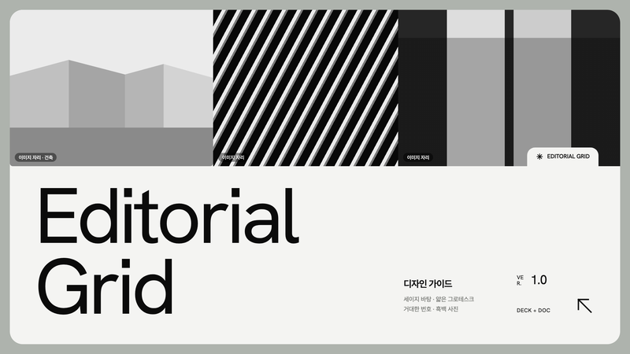
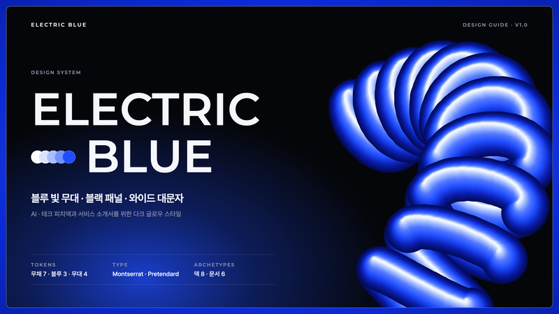
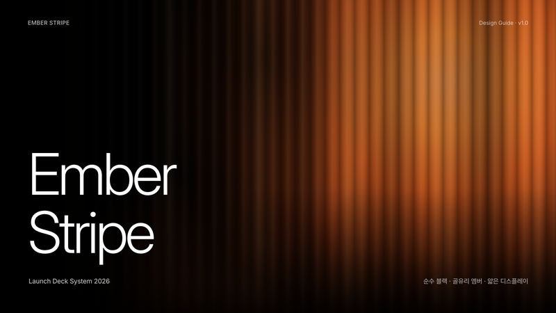
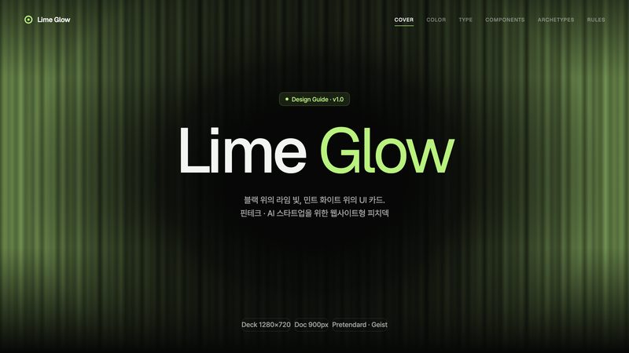
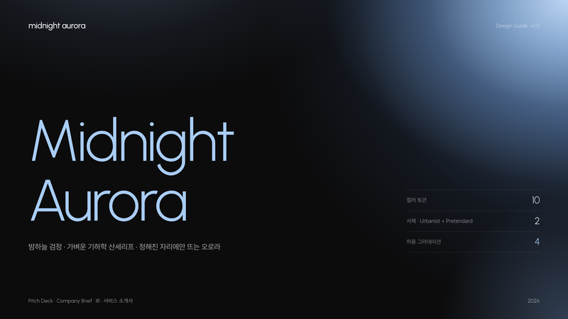
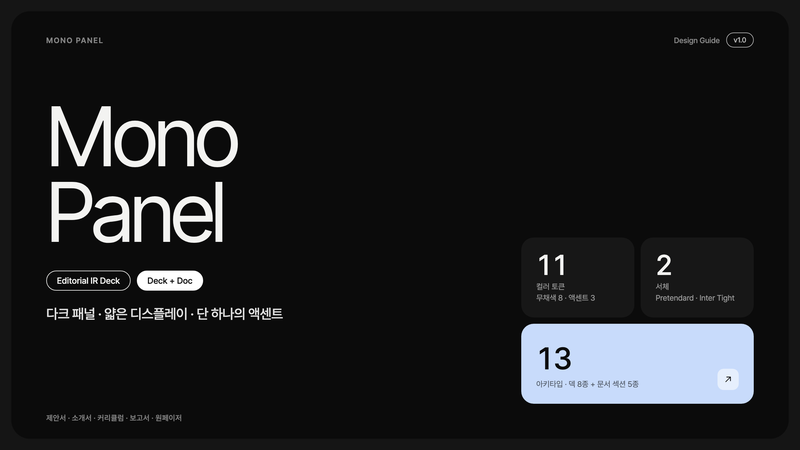
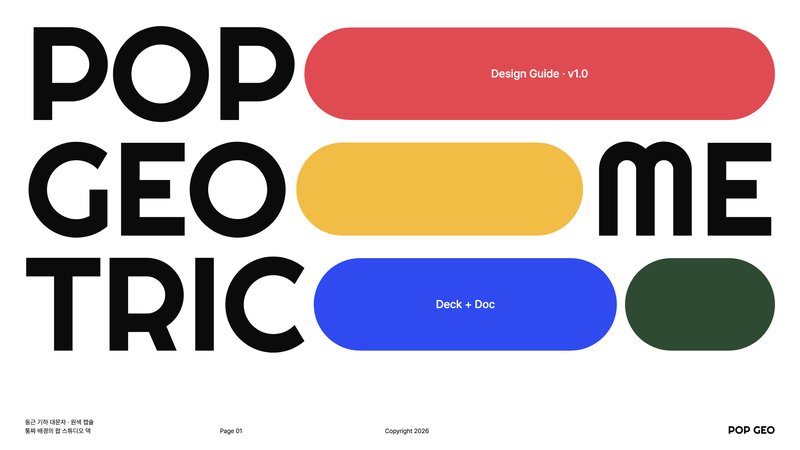
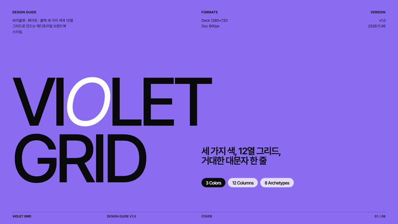

# Design Guide

실제 작업에서 잘 나온 문서 디자인을 **Claude Code 스킬** 형태의 디자인 가이드로 모아 둔 저장소입니다. 폴더 하나를 `~/.claude/skills/`에 복사하면, 어느 Claude Code에서도 같은 톤의 결과물이 나옵니다.

## Designs

<!-- GALLERY:START -->
<table>
<tr><td width="50%" valign="top"><a href="clean-business/"></a><br><b><a href="clean-business/">Clean Business</a></b><br><sub>오프화이트·니어블랙 두 바탕 · 레귤러 그로테스크 대형 제목 · 아웃라인 필과 헤어라인만 쓰는 무채색 기업 덱</sub></td><td width="50%" valign="top"><a href="editorial-grid/"></a><br><b><a href="editorial-grid/">Editorial Grid</a></b><br><sub>세이지 그레이 바탕 · 오프화이트/블랙 카드 · 거대한 번호와 가는 대각 화살표의 흑백 에디토리얼 덱</sub></td></tr>
<tr><td width="50%" valign="top"><a href="electric-blue/"></a><br><b><a href="electric-blue/">Electric Blue</a></b><br><sub>블루 빛 무대 · 블랙 패널 · 와이드 대문자 디스플레이 · 절제된 글로우의 AI·테크 피치덱</sub></td><td width="50%" valign="top"><a href="ember-stripe/"></a><br><b><a href="ember-stripe/">Ember Stripe</a></b><br><sub>순수 블랙 · 골유리 줄무늬로 번지는 엠버 빛 · 얇은 디스플레이와 각진 스탯 카드의 프리미엄 런치 덱</sub></td></tr>
<tr><td width="50%" valign="top"><a href="lime-glow/"></a><br><b><a href="lime-glow/">Lime Glow</a></b><br><sub>블랙 위 라임 글로우 · 민트 화이트 UI 카드 · 가운데 헤드라인의 핀테크·AI 웹사이트형 피치덱</sub></td><td width="50%" valign="top"><a href="midnight-aurora/"></a><br><b><a href="midnight-aurora/">Midnight Aurora</a></b><br><sub>니어블랙 슬라이드 · 가벼운 기하학 산세리프 · 모서리에서 번지는 페일 블루 오로라의 SaaS 피치덱</sub></td></tr>
<tr><td width="50%" valign="top"><a href="mono-panel-design/"></a><br><b><a href="mono-panel-design/">Mono Panel</a></b><br><sub>다크 패널 · 얇은 영문 디스플레이 · 페일 블루 단일 액센트의 에디토리얼 IR덱</sub></td><td width="50%" valign="top"><a href="pop-geometric/"></a><br><b><a href="pop-geometric/">Pop Geometric</a></b><br><sub>꽉 찬 둥근 기하 대문자 · 맞물린 원색 캡슐 · 통짜 원색 배경의 팝 스튜디오 덱</sub></td></tr>
<tr><td width="50%" valign="top"><a href="violet-grid/"></a><br><b><a href="violet-grid/">Violet Grid</a></b><br><sub>바이올렛 · 화이트 · 블랙 풀블리드 페이지에 거대한 대문자 그로테스크와 러닝 푸터를 얹은 에디토리얼 브랜드북</sub></td></tr>
</table>

| 디자인 | 폴더 | 잘 맞는 문서 | 추가일 |
|---|---|---|---|
| [Clean Business](clean-business/) | `clean-business` | 회사 소개서 · 사업 제안서 · 분기 보고서 · 원페이저 | 2026-11-06 |
| [Editorial Grid](editorial-grid/) | `editorial-grid` | 마케팅 계획서 · 회사·서비스 소개서 · 브랜드 제안서 · 포트폴리오 | 2026-11-06 |
| [Electric Blue](electric-blue/) | `electric-blue` | 피치덱 · AI·테크 서비스 소개서 · 성과 보고서 · 로드맵 | 2026-11-06 |
| [Ember Stripe](ember-stripe/) | `ember-stripe` | 제품 출시 발표 · IR · 브랜드 소개서 · 키노트 | 2026-11-06 |
| [Lime Glow](lime-glow/) | `lime-glow` | IR덱 · 서비스 소개서 · 사업계획 요약 · 원페이저 | 2026-11-06 |
| [Midnight Aurora](midnight-aurora/) | `midnight-aurora` | 피치덱 · IR 자료 · 서비스 소개서 · 회사 소개 원페이저 | 2026-11-06 |
| [Mono Panel](mono-panel-design/) | `mono-panel-design` | 제안서 · 소개서 · 커리큘럼 · 보고서 | 2026-11-06 |
| [Pop Geometric](pop-geometric/) | `pop-geometric` | 회사 소개서 · 포트폴리오 · 캠페인 제안서 · 브랜드 덱 | 2026-11-06 |
| [Violet Grid](violet-grid/) | `violet-grid` | 브랜드 가이드 · 회사·서비스 소개서 · 마케팅 제안서 · 성과 리포트 | 2026-11-06 |
<!-- GALLERY:END -->

## 사용법

```bash
git clone https://github.com/im-dullin/design_guide.git
cp -R design_guide/<디자인 폴더> ~/.claude/skills/        # 모든 프로젝트에서 사용
# 또는 <project>/.claude/skills/ 에 복사하면 해당 프로젝트에서만 사용

pip install playwright pillow && python3 -m playwright install chromium   # PDF 렌더용 (한 번만)
```

Claude Code에 "`<디자인 폴더명>` 스킬로 ○○ 만들어줘"라고 요청합니다. 디자인별 상세 내용은 각 폴더의 README에 있습니다.

## 새 디자인 추가 규칙

디자인마다 폴더 하나를 만들고 아래 구성을 맞춥니다.

```
<design-slug>/
├── SKILL.md              필수 · frontmatter(name = 폴더명, description) + 규칙서
├── README.md             필수 · 미리보기 이미지 · 설치 · 사용법
├── design.json           필수 · 갤러리 메타 {name, slug, summary, formats, best_for, added}
├── assets/               CSS · 아이콘 등
├── templates/            시작용 템플릿
├── scripts/              렌더 스크립트
├── guide/                그 디자인으로 만든 '디자인 가이드 샘플' 문서 (html · pdf)
└── preview/
    ├── thumbnail.png     필수 · 800×450 · 루트 갤러리 썸네일
    └── guide/            가이드 샘플 장별 PNG (README 노출용)
```

폴더를 추가한 뒤 아래 명령으로 이 README의 갤러리를 다시 만들고 커밋합니다.

```bash
python3 scripts/update_gallery.py
```
