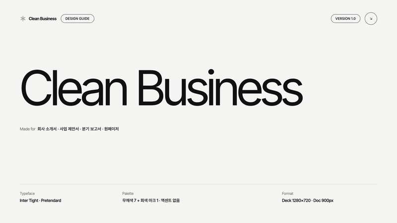
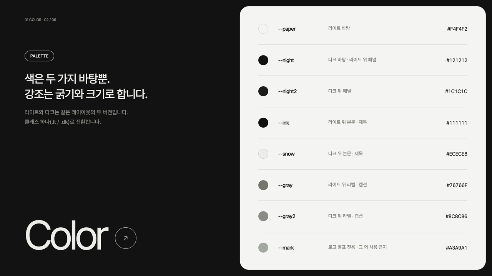
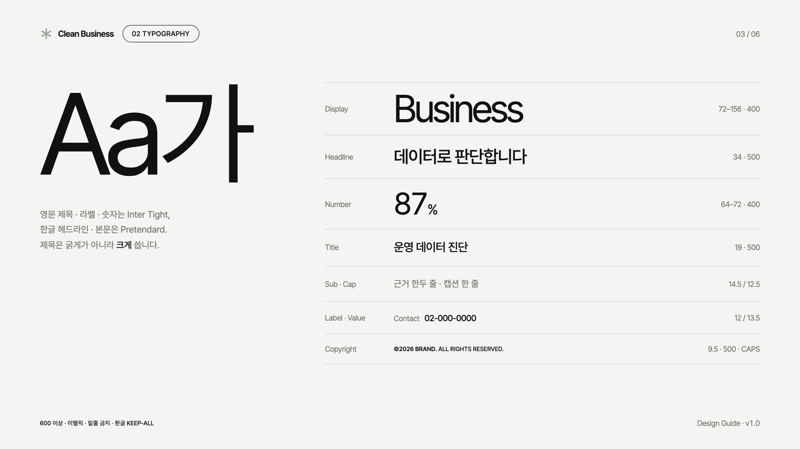
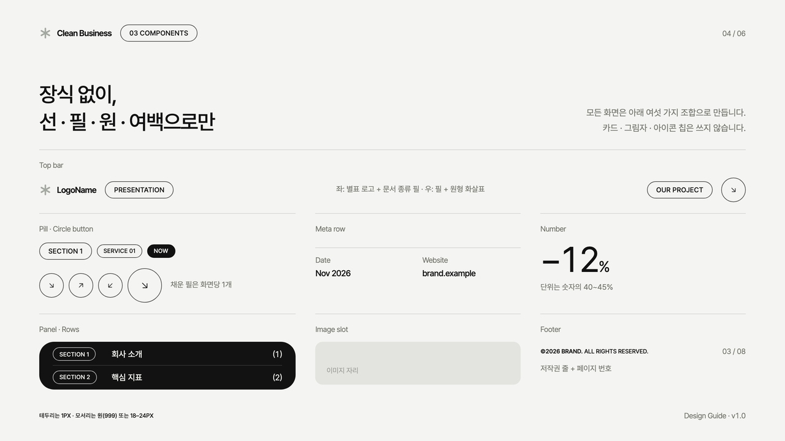
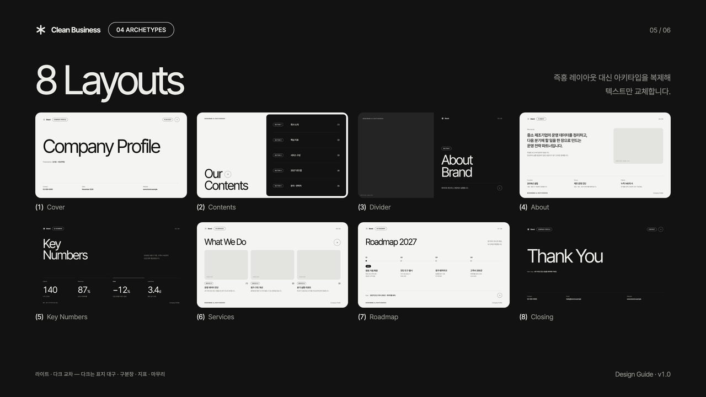
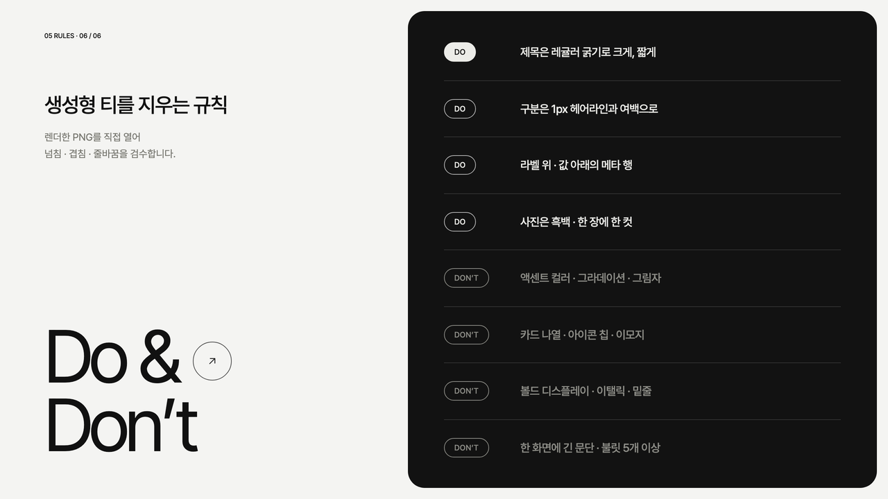
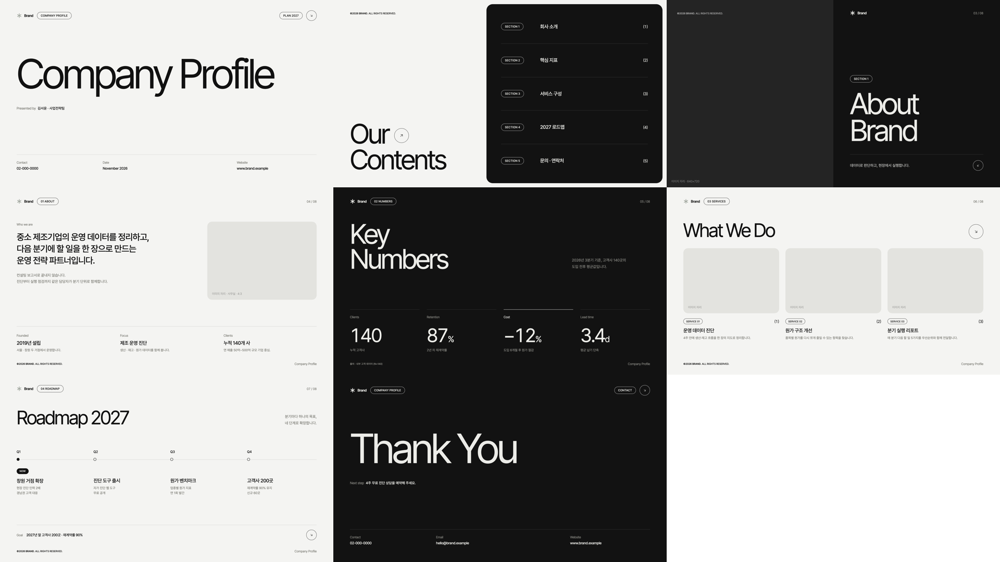
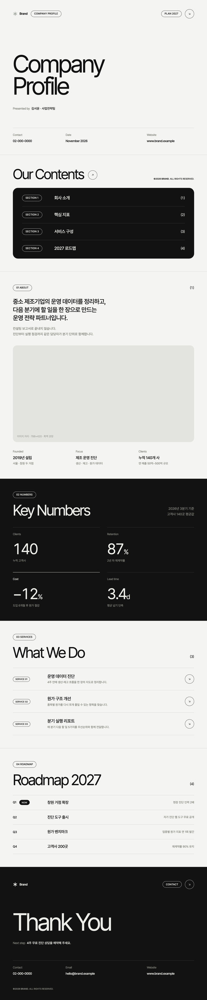

# Clean Business

오프화이트와 니어블랙 두 가지 바탕에 레귤러 굵기의 큰 그로테스크 제목을 두고, 아웃라인 필·원형 화살표·헤어라인만으로 정리하는 무채색 기업 덱 스타일입니다. 회사 소개서·사업 제안서·분기 보고서·원페이저에 씁니다.



| 항목 | 내용 |
|---|---|
| 포맷 | 슬라이드 덱 1280×720 · 세로 롱페이지 900px |
| 서체 | Pretendard (한글·본문) · Inter Tight (영문 디스플레이·라벨·숫자, Helvetica Now Display 계열 대체) |
| 컬러 | 무채색 7 + 로고 마크 회색 1 (`#F4F4F2` · `#121212` · `#A3A9A1`) · 액센트 없음 |
| 테마 | `.lt` 라이트 / `.dk` 다크 클래스 하나로 같은 레이아웃 전환 |
| 잘 맞는 문서 | 회사 소개서, 사업 제안서, 분기·연간 보고서, 원페이저 |

## 디자인 가이드 샘플

이 스타일로 만든 디자인 가이드 문서입니다. PDF는 [`guide/guide-sample.pdf`](guide/guide-sample.pdf), 원본은 [`guide/guide-sample.html`](guide/guide-sample.html)입니다.

| | |
|---|---|
|  |  |
| **Cover** — 표지 구성 | **Color** — 두 바탕 + 회색 마크 |
|  |  |
| **Typography** — 서체 스케일 | **Components** — 상단 바 · 필 · 원형 버튼 · 메타 행 · 패널 |
|  |  |
| **Archetypes** — 슬라이드 8종 | **Do & Don’t** — 생성형 티 지우기 |

## 템플릿 미리보기

**슬라이드 덱** — [`templates/deck.html`](templates/deck.html)



**세로 롱페이지** — [`templates/doc.html`](templates/doc.html)



## 설치

이 폴더를 통째로 Claude Code 스킬 폴더에 복사합니다.

```bash
# 모든 프로젝트에서 사용
cp -R clean-business ~/.claude/skills/
# 특정 프로젝트에서만 사용
cp -R clean-business <project>/.claude/skills/

# PDF 렌더용 (한 번만)
pip install playwright pillow && python3 -m playwright install chromium
```

## 사용

Claude Code에 이렇게 요청합니다.

- "clean-business 스킬로 우리 회사 소개서 8장 만들어줘"
- "이 분기 보고서를 클린 비즈니스 톤 다크 버전으로 정리해줘"

직접 렌더할 때는 아래 명령을 씁니다.

```bash
python3 scripts/render.py templates/deck.html ./out   # PDF + 장별 PNG + 한눈에 보기 이미지
python3 scripts/render.py templates/doc.html ./out    # 한 장 PDF + 전체 캡처
```

- 라이트/다크 전환: 슬라이드·섹션의 `.lt` ↔ `.dk`를 바꾸고, 패널은 `.panel.dk` ↔ `.panel.lt`(또는 `.dk2`)로 바꿉니다.
- 사진 넣기: 템플릿의 "이미지 자리"(`.ph`) 안에 ``를 넣으면 꽉 채움 · 흑백 처리가 자동으로 됩니다. 사진 파일은 결과물 HTML과 같은 폴더에 둡니다.
- 로고 바꾸기: 상단 바의 별표 SVG를 브랜드 로고 SVG(단색, 높이 20px)로 교체합니다. 브랜드 색은 `assets/clean-business.css`의 `--mark` 한 값만 바꿉니다.

## 구성

```
clean-business/
├── SKILL.md                    Claude가 읽는 규칙서 (작업 순서 · 토큰 · 컴포넌트 · 아키타입 · 금지 · 검수)
├── assets/clean-business.css   스타일 (.lt / .dk / .dk2 테마 변수)
├── assets/icons.md             별표 마크 · 원형 화살표
├── templates/                  deck.html · doc.html
├── scripts/render.py           HTML → PDF + 검수 PNG
├── guide/                      디자인 가이드 샘플 (html · pdf · arch 썸네일)
└── preview/                    README용 이미지 · thumbnail.png
```
