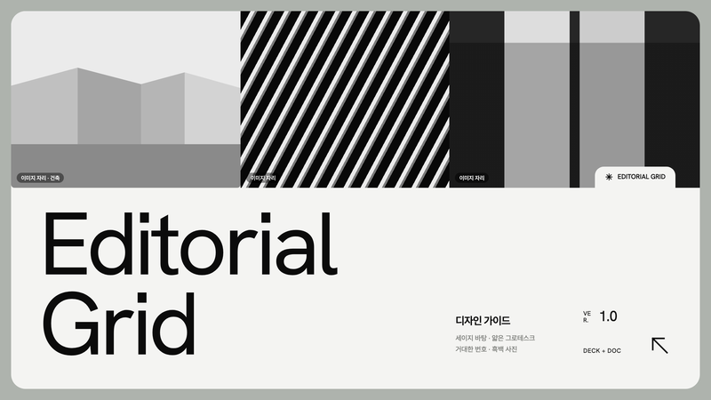
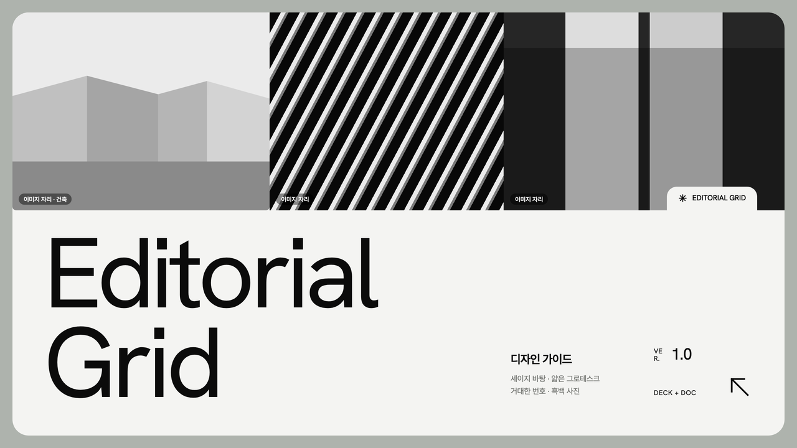
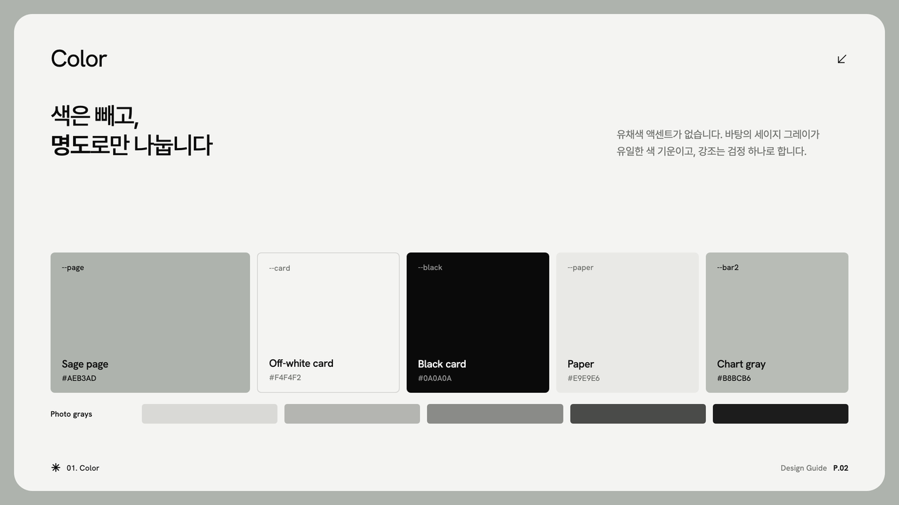
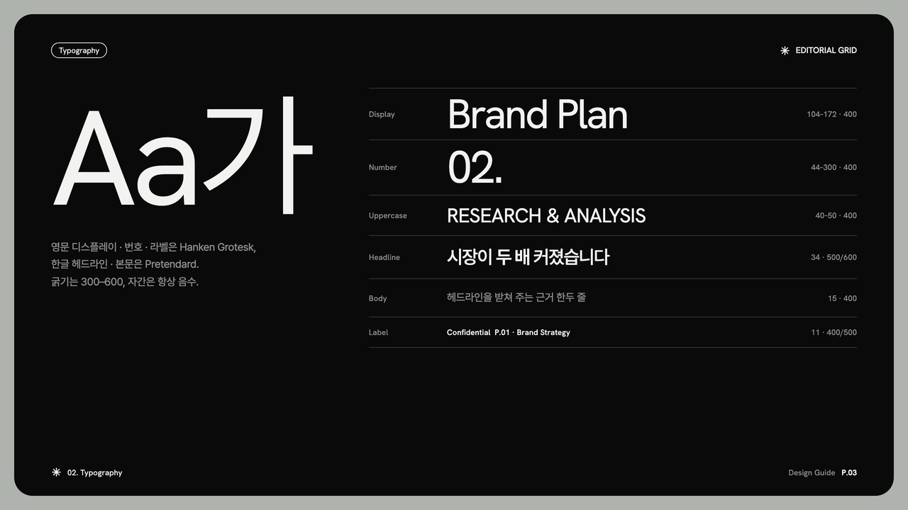
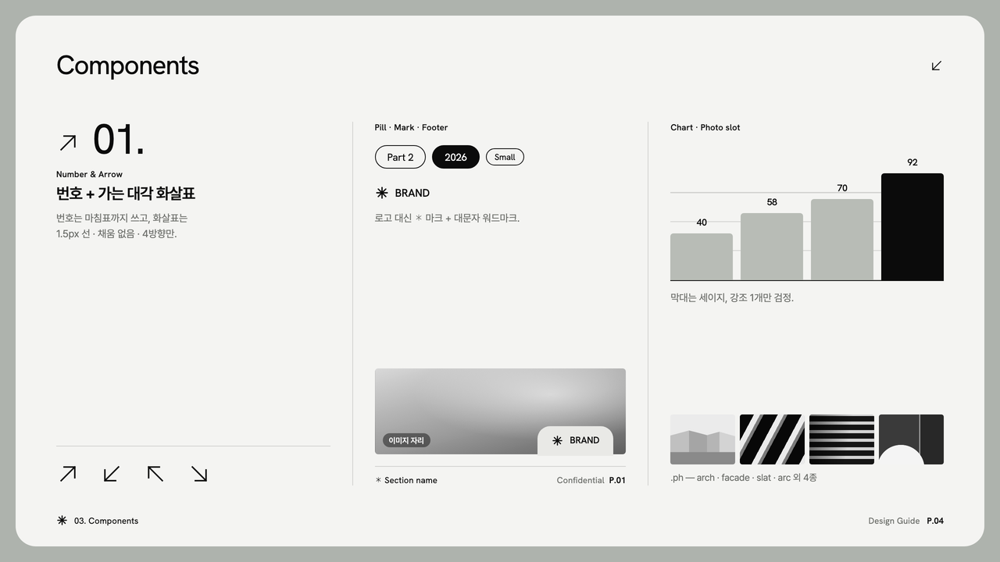
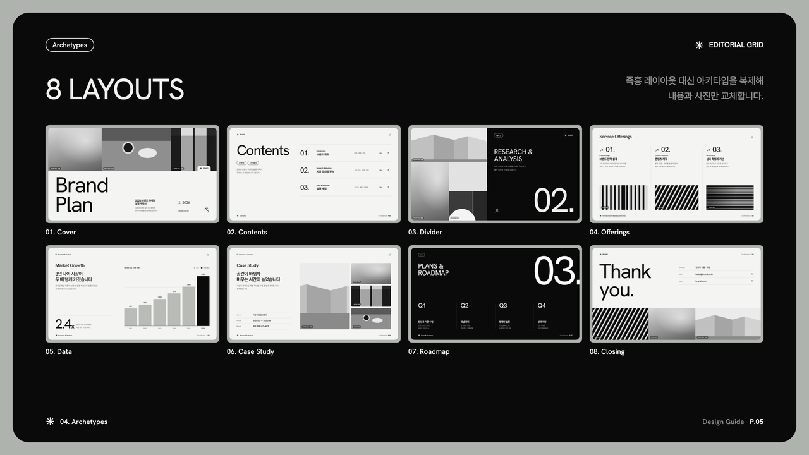
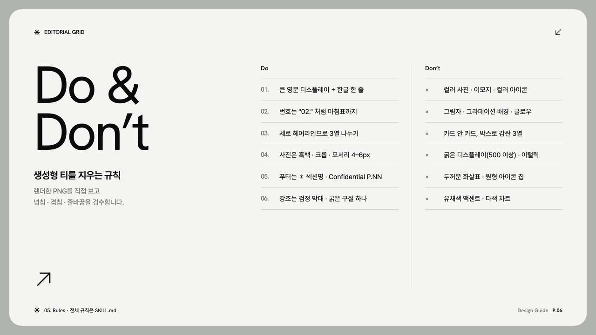
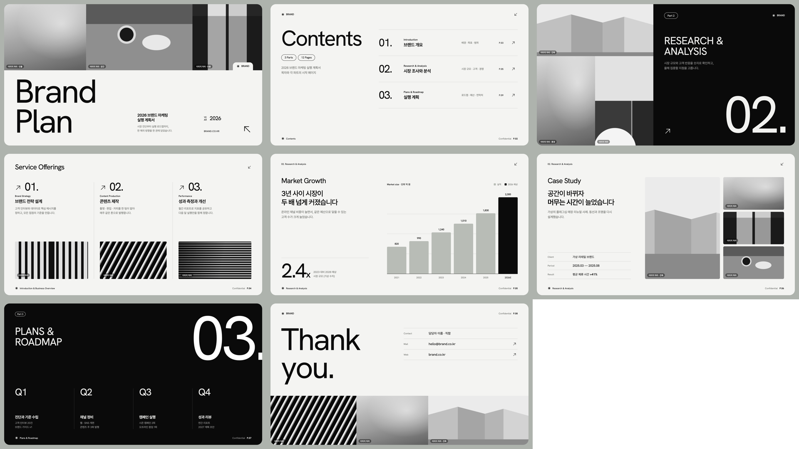
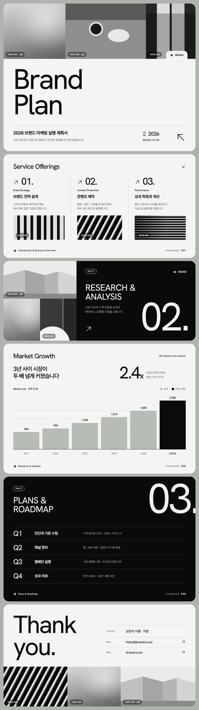

# Editorial Grid

세이지 그레이 바탕에 오프화이트·블랙 카드를 번갈아 얹고, 얇은 그로테스크 디스플레이·거대한 번호("02.")·가는 대각 화살표·흑백 사진 블록으로 구성하는 에디토리얼 덱 스타일입니다. 마케팅 계획서·회사 소개서·브랜드 제안서·포트폴리오에 씁니다.



| 항목 | 내용 |
|---|---|
| 포맷 | 슬라이드 덱 1280×720 · 세로 롱페이지 900px |
| 서체 | Pretendard (한글·본문) · Hanken Grotesk (영문 디스플레이·번호, 상용 네오 그로테스크 대체) |
| 컬러 | 유채색 없음 · 세이지 `#AEB3AD` 바탕 + 오프화이트 `#F4F4F2` · 블랙 `#0A0A0A` |
| 잘 맞는 문서 | 마케팅 계획서, 회사·서비스 소개서, 브랜드 제안서, 포트폴리오 |

## 디자인 가이드 샘플

이 스타일로 만든 디자인 가이드 문서입니다. PDF는 [`guide/guide-sample.pdf`](guide/guide-sample.pdf), 원본은 [`guide/guide-sample.html`](guide/guide-sample.html)입니다.

| | |
|---|---|
|  |  |
| **Cover** — 사진 띠 · 흰 탭 · 대형 디스플레이 | **Color** — 색 없이 명도로만 |
|  |  |
| **Typography** — 서체 스케일 | **Components** — 번호 · 화살표 · 마크 · 차트 · 사진 자리 |
|  |  |
| **Archetypes** — 슬라이드 8종 | **Do & Don’t** — 생성형 티 지우기 |

## 템플릿 미리보기

**슬라이드 덱** — [`templates/deck.html`](templates/deck.html)



**세로 롱페이지** — [`templates/doc.html`](templates/doc.html)



사진은 모두 CSS로 그린 흑백 대체 패턴(`이미지 자리` 라벨)입니다. 실제 사진으로 바꾸는 방법은 `SKILL.md` §4 "사진 자리"에 있습니다.

## 설치

이 폴더를 통째로 Claude Code 스킬 폴더에 복사합니다.

```bash
# 모든 프로젝트에서 사용
cp -R editorial-grid ~/.claude/skills/
# 특정 프로젝트에서만 사용
cp -R editorial-grid <project>/.claude/skills/

# PDF 렌더용 (한 번만)
pip install playwright pillow && python3 -m playwright install chromium
```

## 사용

Claude Code에 이렇게 요청합니다.

- "editorial-grid 스킬로 2026 마케팅 계획서 10장 만들어줘"
- "이 회사 소개서를 에디토리얼 그리드 톤 한 장짜리 웹뷰 PDF로 정리해줘"

직접 렌더할 때는 아래 명령을 씁니다.

```bash
python3 scripts/render.py templates/deck.html ./out   # PDF + 장별 PNG + 한눈에 보기 이미지
python3 scripts/render.py templates/doc.html ./out    # 한 장 PDF + 전체 캡처
```

바탕 톤을 바꾸려면 `assets/editorial.css` 맨 위의 `--page`만 채도 낮은 회색조로 바꿉니다.

## 구성

```
editorial-grid/
├── SKILL.md                Claude가 읽는 규칙서 (작업 순서 · 토큰 · 컴포넌트 · 사진 자리 · 아키타입 · 금지 · 검수)
├── assets/editorial.css    스타일 · 토큰 · 사진 대체 패턴 8종
├── assets/icons.md         대각 화살표 4종 + ✱ 마크
├── templates/              deck.html · doc.html
├── scripts/render.py       HTML → PDF + 검수 PNG
├── guide/                  디자인 가이드 샘플 (html · pdf · 아키타입 썸네일)
└── preview/                README용 이미지 · thumbnail.png
```
