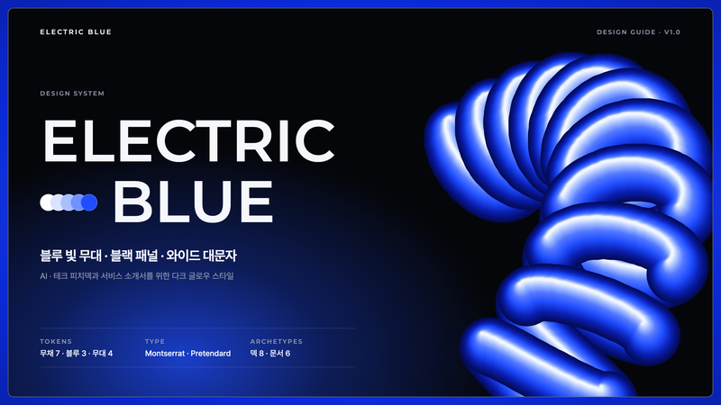
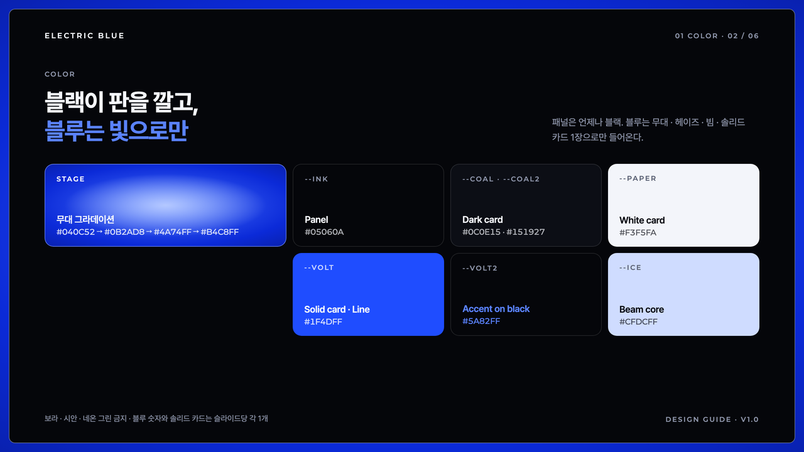
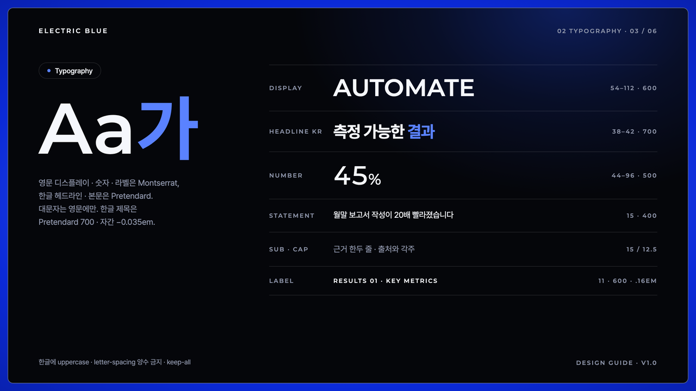
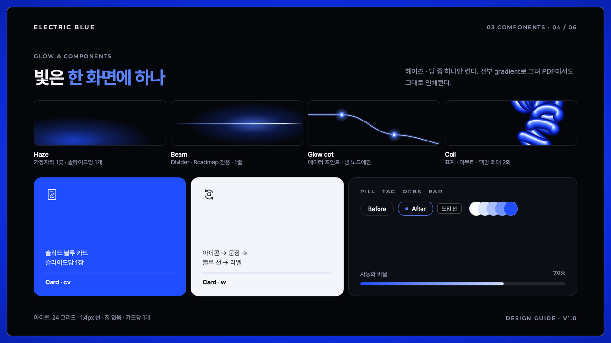
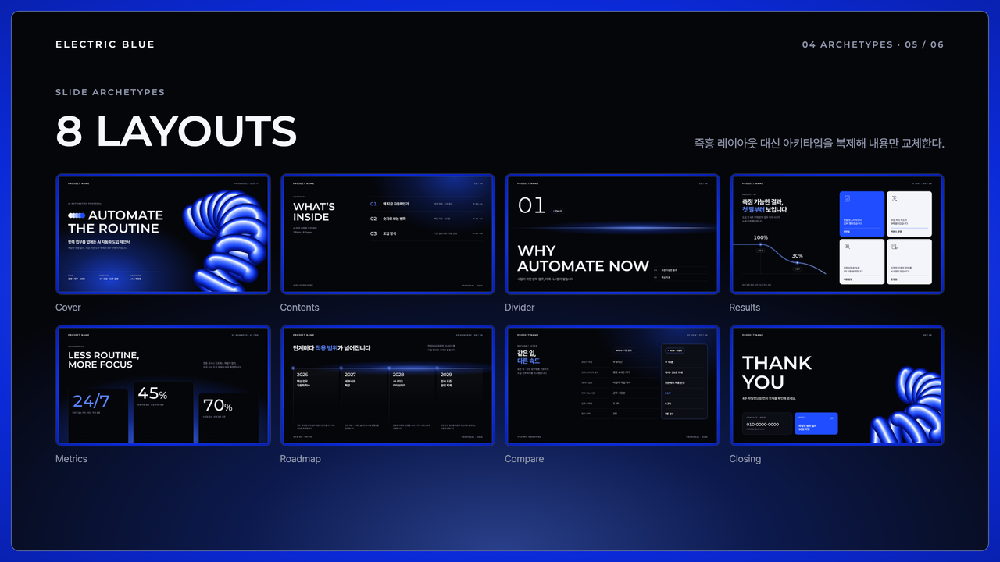
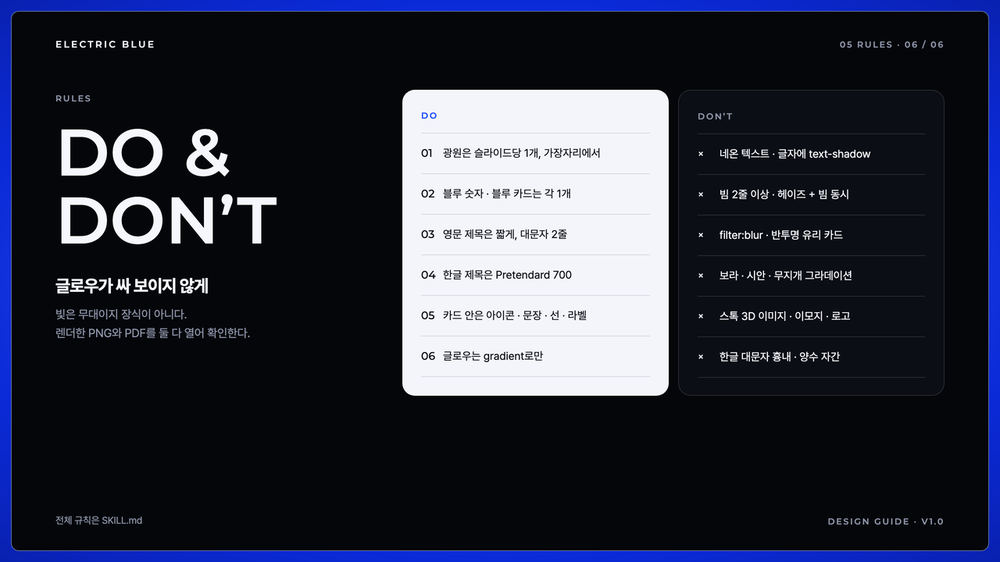
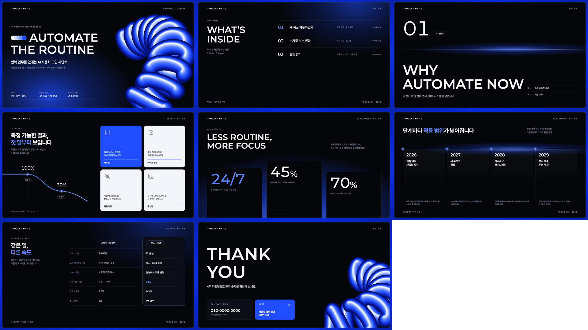
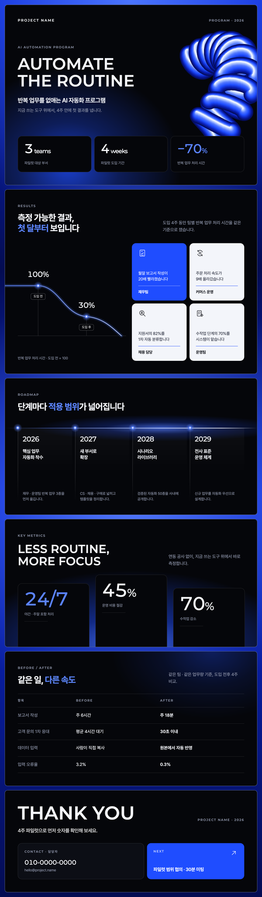

# Electric Blue

블루 빛 무대 위에 블랙 패널을 얹고, 와이드 대문자 영문 제목과 선 아이콘 카드, 절제된 글로우(헤이즈 · 빔 · 3D 코일)로 마무리하는 AI·테크 피치덱 스타일입니다. 피치덱·서비스 소개서·성과 보고서·로드맵에 씁니다.



| 항목 | 내용 |
|---|---|
| 포맷 | 슬라이드 덱 1280×720 · 세로 롱페이지 900px |
| 서체 | Pretendard (한글·본문) · Montserrat (영문 대문자 디스플레이·숫자·라벨, 유료 와이드 지오메트릭 산세리프 대체) |
| 컬러 | 블랙 패널 + 무채 7 + 블루 3 (`#1F4DFF` · `#5A82FF` · `#CFDCFF`) + 무대 그라데이션 4 |
| 글로우 | 헤이즈 · 빔 · 글로우 점 · 코일 — 전부 CSS/SVG 그라데이션, PDF 인쇄 그대로 |
| 잘 맞는 문서 | AI·SaaS 피치덱, 테크 서비스 소개서, 도입 성과 보고서, 연도별 로드맵 |

## 디자인 가이드 샘플

이 스타일로 만든 디자인 가이드 문서입니다. PDF는 [`guide/guide-sample.pdf`](guide/guide-sample.pdf), 원본은 [`guide/guide-sample.html`](guide/guide-sample.html)입니다.

| | |
|---|---|
|  |  |
| **Cover** — 표지 구성 | **Color** — 블랙 패널 + 빛으로만 쓰는 블루 |
|  |  |
| **Typography** — 영문 대문자 · 한글 700 | **Components** — 글로우 4종 · 카드 · 필 |
|  |  |
| **Archetypes** — 슬라이드 8종 | **Do & Don’t** — 글로우가 싸 보이지 않게 |

## 템플릿 미리보기

**슬라이드 덱** — [`templates/deck.html`](templates/deck.html)



**세로 롱페이지** — [`templates/doc.html`](templates/doc.html)



## 설치

이 폴더를 통째로 Claude Code 스킬 폴더에 복사합니다.

```bash
# 모든 프로젝트에서 사용
cp -R electric-blue ~/.claude/skills/
# 특정 프로젝트에서만 사용
cp -R electric-blue <project>/.claude/skills/

# PDF 렌더용 (한 번만)
pip install playwright pillow && python3 -m playwright install chromium
```

## 사용

Claude Code에 이렇게 요청합니다.

- "electric-blue 스킬로 AI 자동화 서비스 피치덱 10장 만들어줘"
- "이 성과 보고서를 일렉트릭 블루 톤 한 장짜리 웹뷰 PDF로 정리해줘"

직접 렌더할 때는 아래 명령을 씁니다.

```bash
python3 scripts/render.py templates/deck.html ./out   # PDF + 장별 PNG + 한눈에 보기 이미지
python3 scripts/render.py templates/doc.html ./out    # 한 장 PDF + 전체 캡처
python3 scripts/coil.py 11 c -40 > coil.svg           # 3D 코일 오브젝트 새로 만들기 (감은 수 · id · 회전)
```

브랜드 색을 쓰려면 `assets/electric-blue.css` 맨 위의 `--volt`, `--volt2`, `--ice`와 무대 4토큰(`--stage0~2`, `--halo`)을 같은 계열로 바꾸고, 코일 색은 `scripts/coil.py`의 `ramp`를 바꿉니다.

## 구성

```
electric-blue/
├── SKILL.md                 Claude가 읽는 규칙서 (작업 순서 · 글로우 규칙 · 토큰 · 컴포넌트 · 아키타입 · 금지 · 검수)
├── assets/electric-blue.css 스타일
├── assets/icons.md          얇은 선 아이콘 14종
├── templates/               deck.html · doc.html
├── scripts/render.py        HTML → PDF + 검수 PNG
├── scripts/coil.py          유광 3D 코일 SVG 생성기 (필터 없음)
├── guide/                   디자인 가이드 샘플 (html · pdf)
└── preview/                 README용 이미지 · thumbnail.png
```
