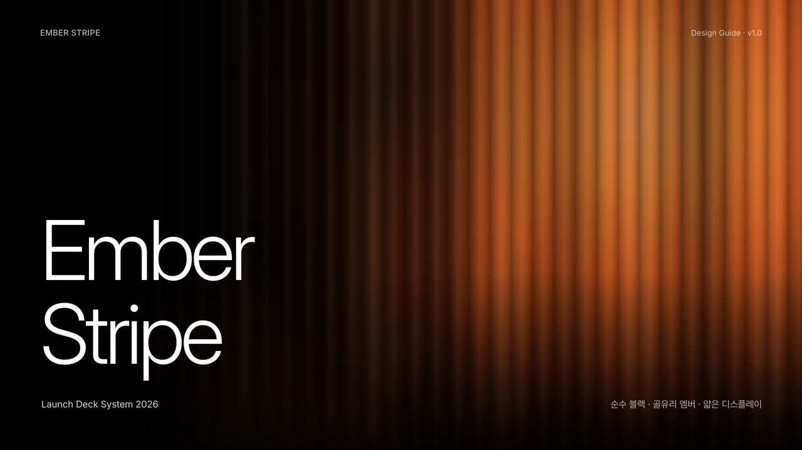
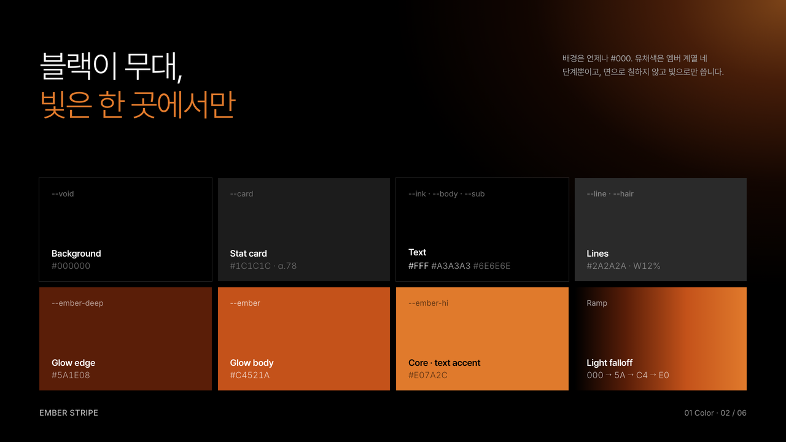
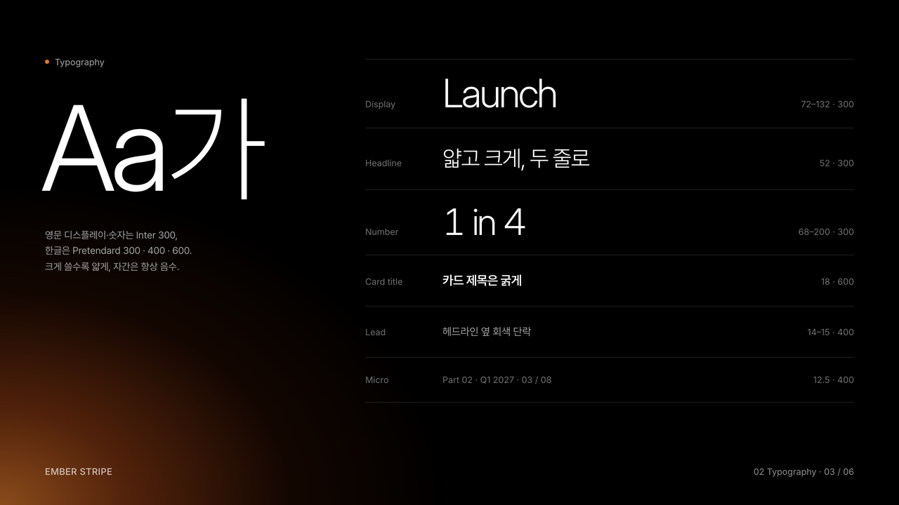
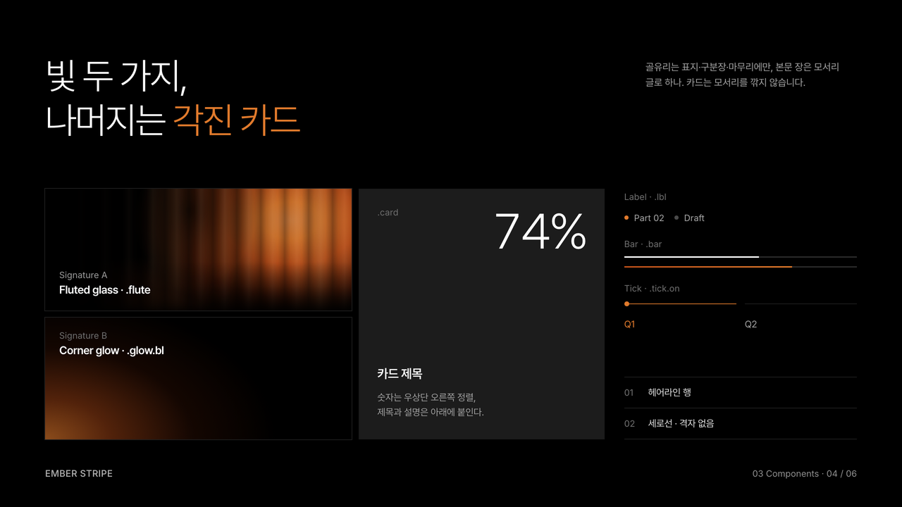
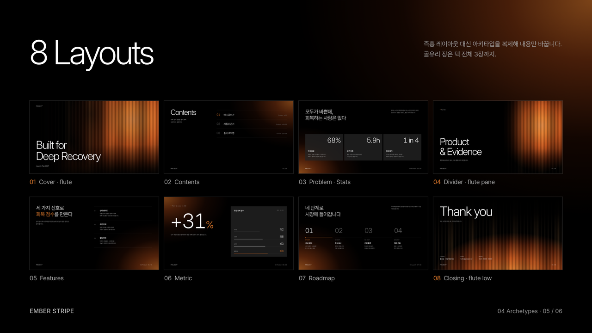
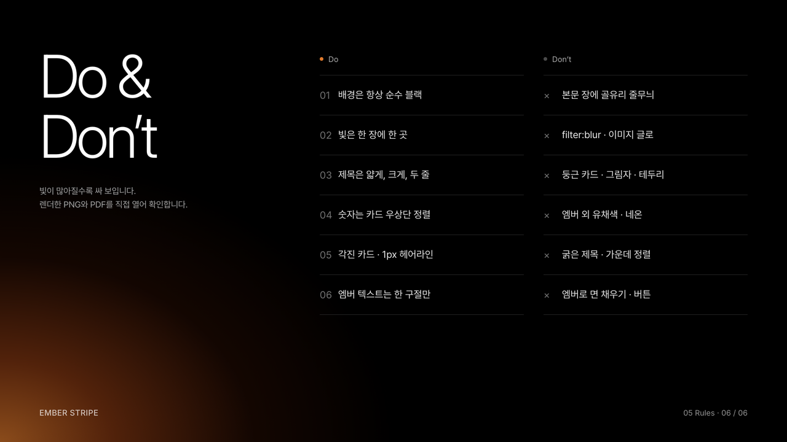
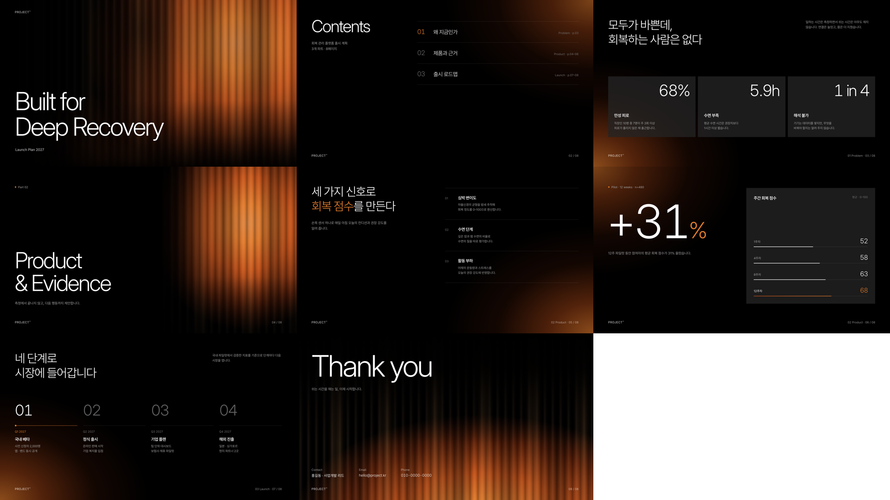
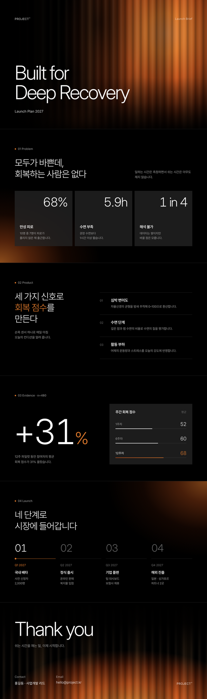

# Ember Stripe

순수 블랙 위에 엠버 빛 하나를 비추는 프리미엄 런치 덱 스타일입니다. 표지에서는 빛이 세로 골유리 줄무늬로 갈라지고, 본문 장에는 모서리 글로만 남깁니다. 제품 출시 발표·IR·브랜드 소개서·키노트에 씁니다.


| 항목 | 내용 |
|---|---|
| 포맷 | 슬라이드 덱 1280×720 · 세로 롱페이지 900px |
| 서체 | Pretendard (한글, 300 중심) · Inter 300 (영문 디스플레이·숫자) |
| 컬러 | 블랙·그레이 7 + 엠버 4 (`#5A1E08` · `#C4521A` · `#E07A2C` · `#F0A868`) |
| 시그니처 | CSS 그라데이션만으로 만든 골유리 줄무늬(`.flute`)와 코너 글로(`.glow`) — PDF에서도 유지 |
| 잘 맞는 문서 | 제품 출시 발표, 투자 IR, 브랜드 소개서, 키노트, 런치 원페이저 |

## 디자인 가이드 샘플

이 스타일로 만든 디자인 가이드 문서입니다. PDF는 [`guide/guide-sample.pdf`](guide/guide-sample.pdf), 원본은 [`guide/guide-sample.html`](guide/guide-sample.html)입니다.

| | |
|---|---|
|  |  |
| **Cover** — 골유리 풀블리드 표지 | **Color** — 블랙 무대 + 엠버 4단계 |
|  |  |
| **Typography** — 얇고 크게 | **Components** — 빛 두 가지 · 각진 카드 |
|  |  |
| **Archetypes** — 슬라이드 8종 | **Do & Don’t** — 빛의 절제 |

## 템플릿 미리보기

**슬라이드 덱** — [`templates/deck.html`](templates/deck.html)



**세로 롱페이지** — [`templates/doc.html`](templates/doc.html)



## 설치

이 폴더를 통째로 Claude Code 스킬 폴더에 복사합니다.

```bash
# 모든 프로젝트에서 사용
cp -R ember-stripe ~/.claude/skills/
# 특정 프로젝트에서만 사용
cp -R ember-stripe <project>/.claude/skills/

# PDF 렌더용 (한 번만)
pip install playwright pillow && python3 -m playwright install chromium
```

## 사용

Claude Code에 이렇게 요청합니다.

- "ember-stripe 스킬로 신제품 출시 발표 10장 만들어줘"
- "이 IR 자료를 엠버 스트라이프 톤 한 장짜리 웹뷰 PDF로 정리해줘"

직접 렌더할 때는 아래 명령을 씁니다.

```bash
python3 scripts/render.py templates/deck.html ./out   # PDF + 장별 PNG + 한눈에 보기 이미지
python3 scripts/render.py templates/doc.html ./out    # 한 장 PDF + 전체 캡처
```

브랜드 색을 쓰려면 `assets/ember.css` 맨 위의 엠버 4개 토큰과 같은 파일 안의 rgba 값(224,122,44 · 196,82,26 · 90,30,8)을 같은 계열로 바꿉니다. 블랙·그레이는 유지합니다.

## 구성

```
ember-stripe/
├── SKILL.md              Claude가 읽는 규칙서 (작업 순서 · 빛 규칙 · 토큰 · 컴포넌트 · 아키타입 · 금지 · 검수)
├── assets/ember.css      스타일 (토큰 · 골유리 · 코너 글로 · 카드)
├── templates/            deck.html · doc.html
├── scripts/render.py     HTML → PDF + 검수 PNG
├── guide/                디자인 가이드 샘플 (html · pdf · 아키타입 썸네일)
└── preview/              README용 이미지 · thumbnail.png
```
