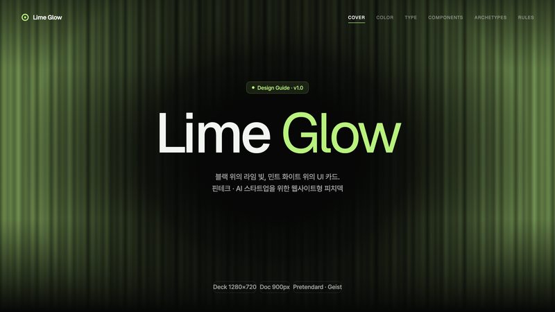
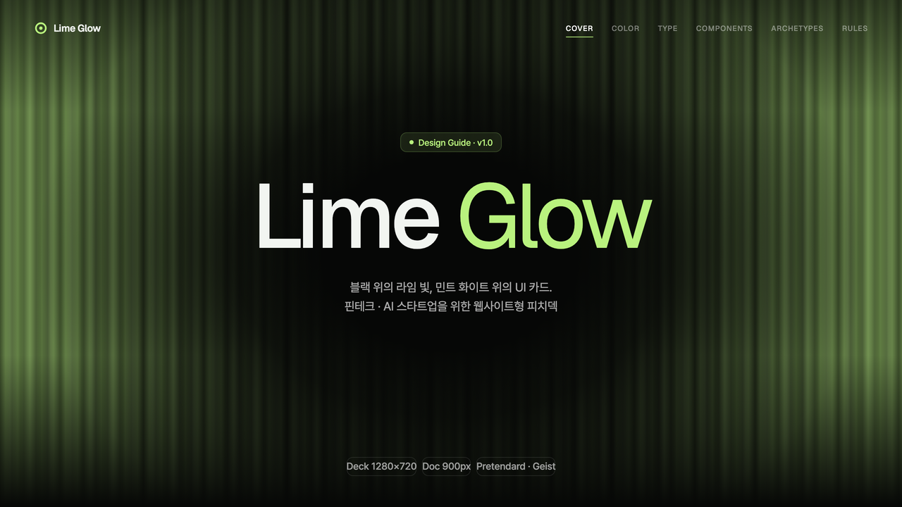
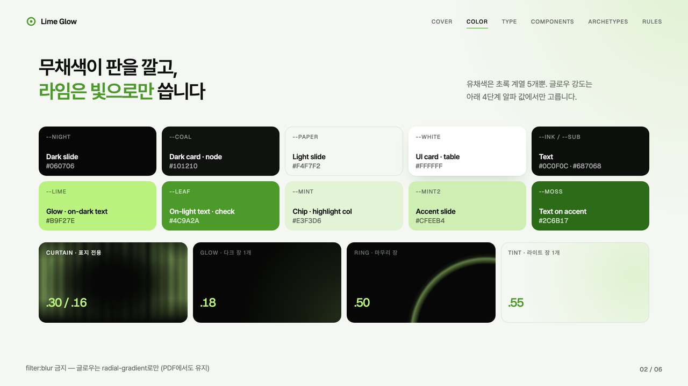
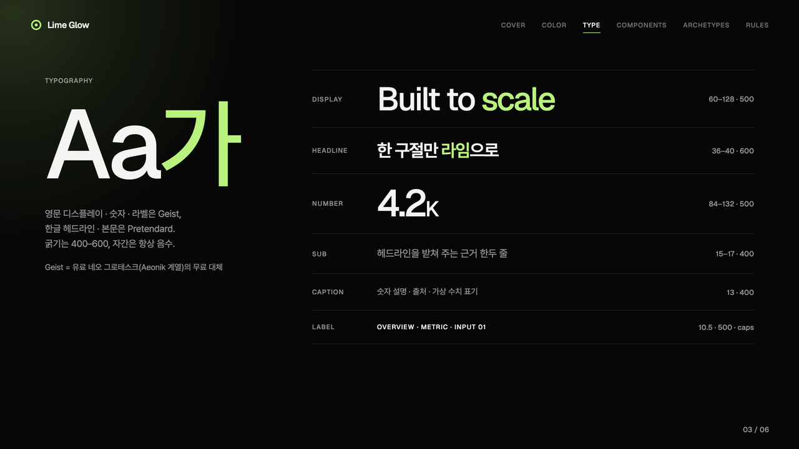
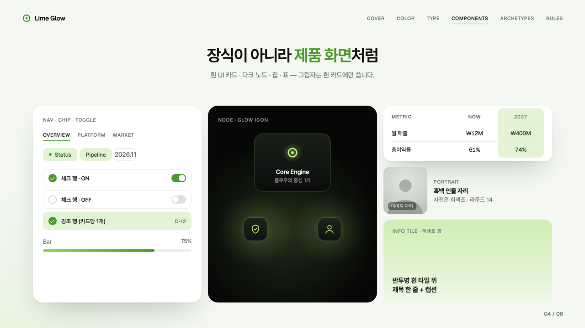
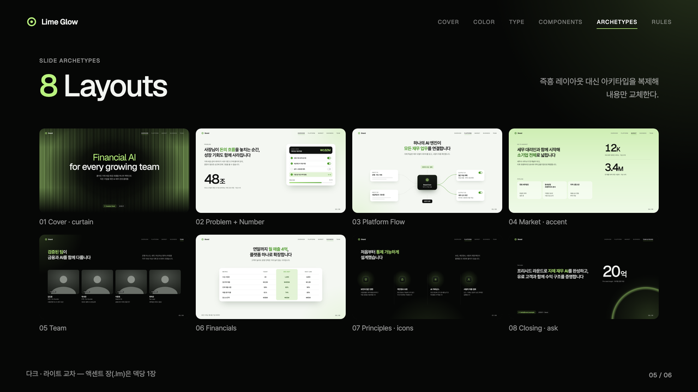
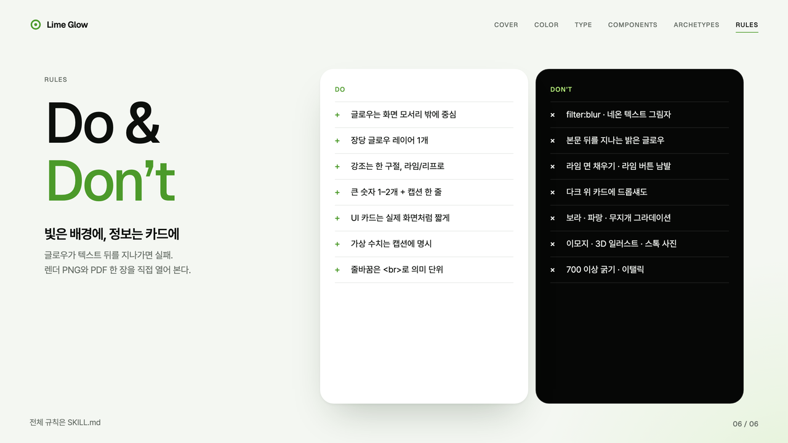
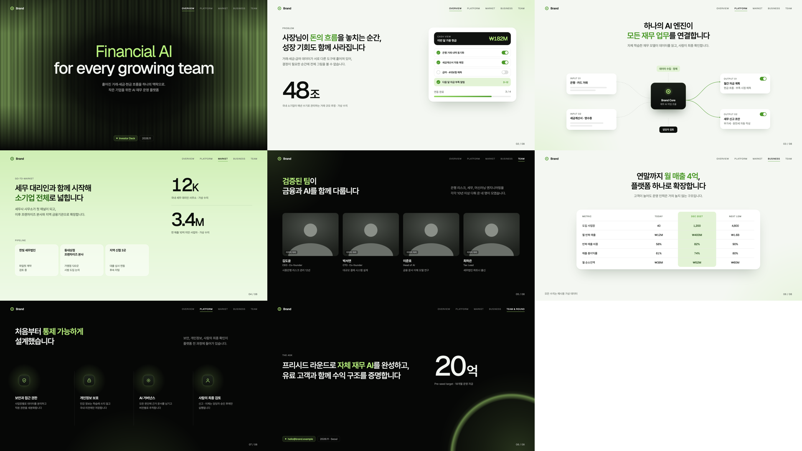
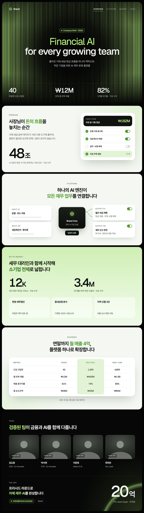

# Lime Glow

블랙 슬라이드 위에 라임 그린 빛 커튼과 원형 글로우를 깔고, 아주 옅은 민트 화이트 슬라이드에는 흰 UI 카드 목업을 얹는 핀테크·AI 스타트업 웹사이트형 피치덱 스타일입니다. IR덱·서비스 소개서·사업계획 요약·원페이저에 씁니다.



| 항목 | 내용 |
|---|---|
| 포맷 | 슬라이드 덱 1280×720 · 세로 롱페이지 900px |
| 서체 | Pretendard (한글·본문) · Geist (영문 디스플레이·숫자·라벨 — 유료 네오 그로테스크 대체) |
| 컬러 | 뉴트럴 5 + 그린 5 (`#B9F27E` · `#4C9A2A` · `#E3F3D6` · `#CFEEB4` · `#2C6B17`) |
| 글로우 | 커튼 · 원형 · 링 · 틴트 4종, 장당 1개, gradient로만 (PDF 유지) |
| 잘 맞는 문서 | 투자 IR덱, AI·핀테크 서비스 소개서, 사업계획 요약, 원페이저 |

## 디자인 가이드 샘플

이 스타일로 만든 디자인 가이드 문서입니다. PDF는 [`guide/guide-sample.pdf`](guide/guide-sample.pdf), 원본은 [`guide/guide-sample.html`](guide/guide-sample.html)입니다.

| | |
|---|---|
|  |  |
| **Cover** — 라임 커튼 글로우 표지 | **Color** — 뉴트럴 + 그린 5 · 글로우 강도 4단계 |
|  |  |
| **Typography** — Geist + Pretendard 스케일 | **Components** — 내비 · 칩 · UI 카드 · 노드 · 표 |
|  |  |
| **Archetypes** — 슬라이드 8종 | **Do & Don’t** — 빛은 배경에, 정보는 카드에 |

## 템플릿 미리보기

**슬라이드 덱** — [`templates/deck.html`](templates/deck.html)



**세로 롱페이지** — [`templates/doc.html`](templates/doc.html)



## 설치

이 폴더를 통째로 Claude Code 스킬 폴더에 복사합니다.

```bash
# 모든 프로젝트에서 사용
cp -R lime-glow ~/.claude/skills/
# 특정 프로젝트에서만 사용
cp -R lime-glow <project>/.claude/skills/

# PDF 렌더용 (한 번만)
pip install playwright pillow && python3 -m playwright install chromium
```

## 사용

Claude Code에 이렇게 요청합니다.

- "lime-glow 스킬로 우리 AI 서비스 IR덱 10장 만들어줘"
- "이 사업계획을 라임 글로우 톤 한 장짜리 웹뷰 PDF로 정리해줘"

직접 렌더할 때는 아래 명령을 씁니다.

```bash
python3 scripts/render.py templates/deck.html ./out   # PDF + 장별 PNG + 한눈에 보기 이미지
python3 scripts/render.py templates/doc.html ./out    # 한 장 PDF + 전체 캡처
```

브랜드 색을 쓰려면 `assets/lime-glow.css` 맨 위의 `--lime`, `--leaf`, `--mint`, `--mint2`, `--moss`를 같은 계열의 밝기 단계로 함께 바꿉니다. 글로우는 `--lime`의 RGB 값을 쓰므로 `.curtain`·`.glow`·`.ring`·`.gico`의 `rgba(185,242,126,…)`도 같이 바꿉니다.

## 구성

```
lime-glow/
├── SKILL.md                 Claude가 읽는 규칙서 (작업 순서 · 토큰 · 글로우 규칙 · 컴포넌트 · 아키타입 · 금지 · 검수)
├── assets/lime-glow.css     스타일 · 토큰
├── assets/icons.md          글로우 칩용 선 아이콘 10종
├── templates/               deck.html · doc.html
├── scripts/render.py        HTML → PDF + 검수 PNG
├── guide/                   디자인 가이드 샘플 (html · pdf · arch 썸네일)
└── preview/                 README용 이미지 · thumbnail.png
```
