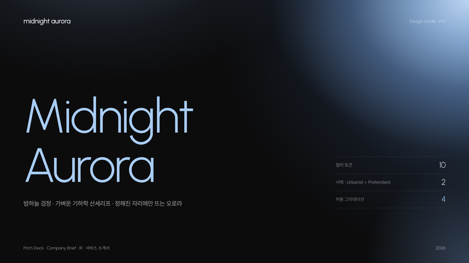
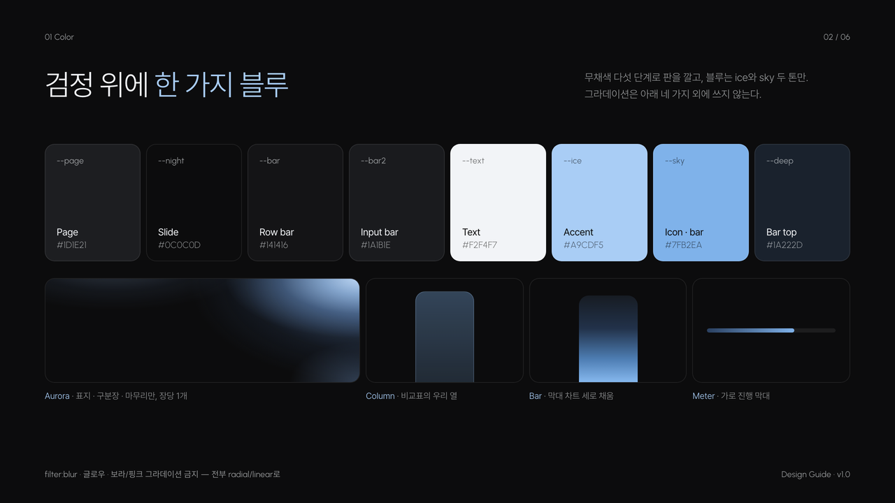
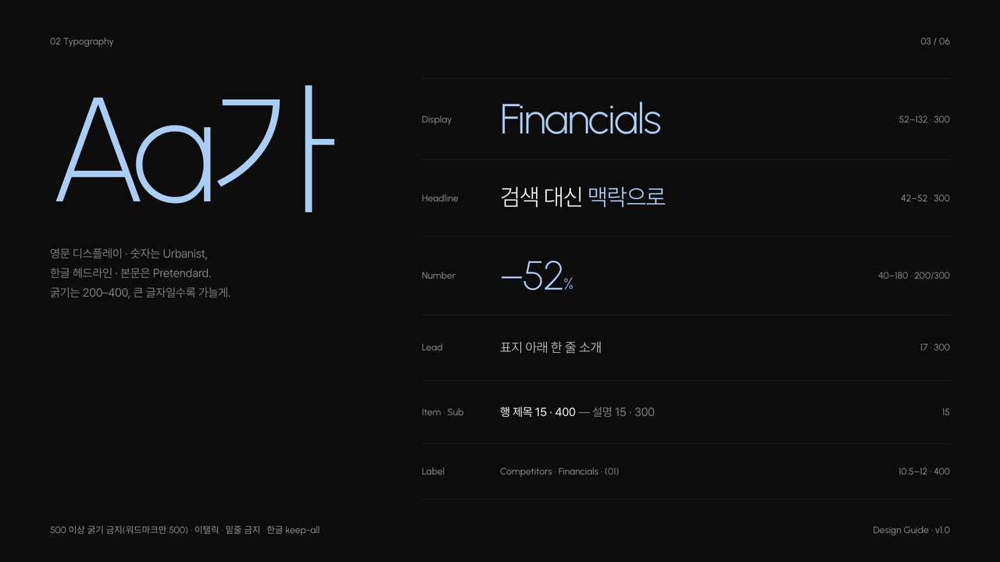
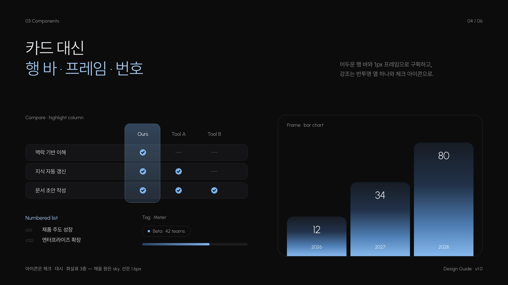
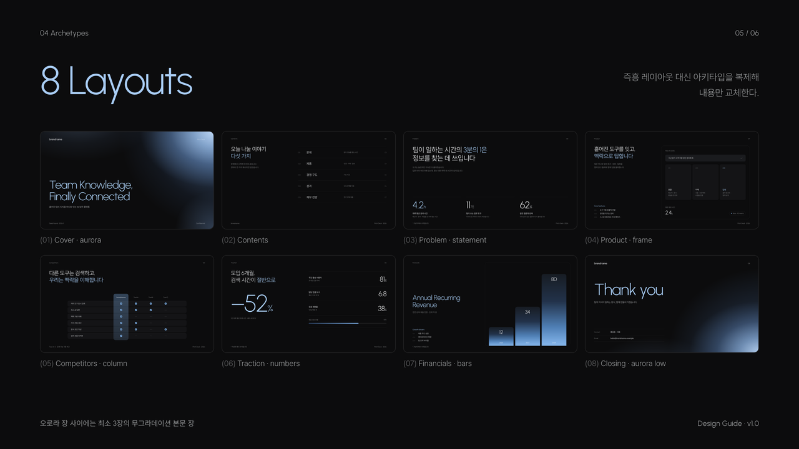
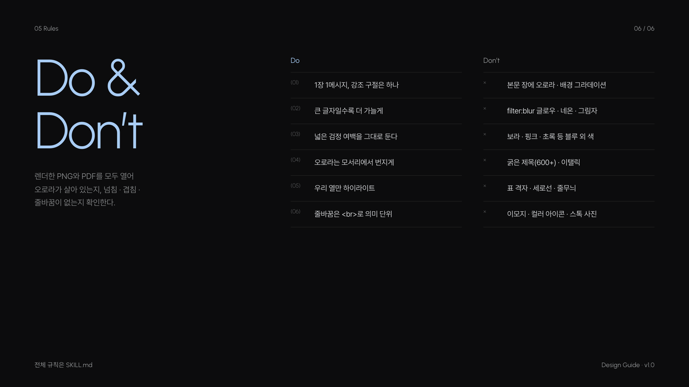
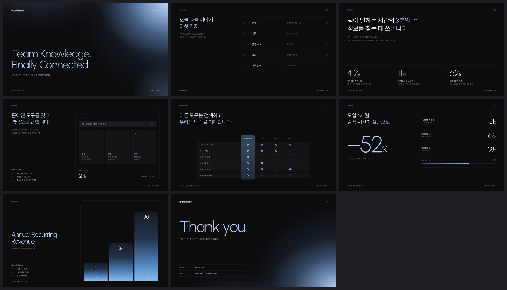
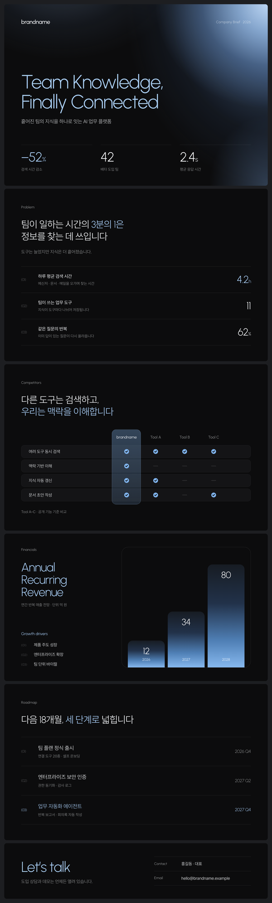

# Midnight Aurora

거의 검정인 슬라이드 위에 가벼운 기하학 산세리프와 페일 스카이 블루 한 가지만 두고, 표지 모서리에서만 오로라 그라데이션이 번지는 SaaS 피치덱 스타일입니다. 피치덱·IR 자료·서비스 소개서·회사 소개 원페이저에 씁니다.



| 항목 | 내용 |
|---|---|
| 포맷 | 슬라이드 덱 1280×720 · 세로 롱페이지 900px |
| 서체 | Urbanist (영문 디스플레이·숫자) · Pretendard Light (한글·본문) |
| 컬러 | 무채색 6 + 블루 3 (`#A9CDF5` · `#7FB2EA` · `#1A222D`) |
| 그라데이션 | Aurora(표지·마무리) · Column(비교표) · Bar(막대) · Meter — 장당 한 종류 |
| 잘 맞는 문서 | 스타트업 피치덱, 투자 IR, SaaS 서비스 소개서, 회사 소개 원페이저 |

## 디자인 가이드 샘플

이 스타일로 만든 디자인 가이드 문서입니다. PDF는 [`guide/guide-sample.pdf`](guide/guide-sample.pdf), 원본은 [`guide/guide-sample.html`](guide/guide-sample.html)입니다.

| | |
|---|---|
|  |  |
| **Cover** — 우상단 오로라 표지 | **Color** — 검정 위 한 가지 블루 · 그라데이션 4종 |
|  |  |
| **Typography** — 크게 쓸수록 가늘게 | **Components** — 행 바 · 하이라이트 열 · 프레임 막대 |
|  |  |
| **Archetypes** — 슬라이드 8종 | **Do & Don’t** — 생성형 티 지우기 |

## 템플릿 미리보기

**슬라이드 덱** — [`templates/deck.html`](templates/deck.html)



**세로 롱페이지** — [`templates/doc.html`](templates/doc.html)



## 설치

이 폴더를 통째로 Claude Code 스킬 폴더에 복사합니다.

```bash
# 모든 프로젝트에서 사용
cp -R midnight-aurora ~/.claude/skills/
# 특정 프로젝트에서만 사용
cp -R midnight-aurora <project>/.claude/skills/

# PDF 렌더용 (한 번만)
pip install playwright pillow && python3 -m playwright install chromium
```

## 사용

Claude Code에 이렇게 요청합니다.

- "midnight-aurora 스킬로 우리 서비스 시드 라운드 피치덱 10장 만들어줘"
- "이 회사 소개를 미드나잇 오로라 톤 한 장짜리 웹뷰 PDF로 정리해줘"

직접 렌더할 때는 아래 명령을 씁니다.

```bash
python3 scripts/render.py templates/deck.html ./out   # PDF + 장별 PNG + 한눈에 보기 이미지
python3 scripts/render.py templates/doc.html ./out    # 한 장 PDF + 전체 캡처
```

브랜드 색을 쓰려면 `assets/midnight-aurora.css` 맨 위의 `--ice`, `--sky`와 `--g-*` 그라데이션 변수 안의 블루 값만 바꿉니다. 오로라는 전부 CSS 그라데이션이라 PDF에서도 그대로 인쇄됩니다.

## 구성

```
midnight-aurora/
├── SKILL.md                     Claude가 읽는 규칙서 (작업 순서 · 토큰 · 그라데이션 규칙 · 컴포넌트 · 아키타입 · 금지 · 검수)
├── assets/midnight-aurora.css   스타일 · 토큰
├── assets/icons.md              체크 · 대시 · 보조 선 아이콘
├── templates/                   deck.html · doc.html
├── scripts/render.py            HTML → PDF + 검수 PNG
├── guide/                       디자인 가이드 샘플 (html · pdf · 아키타입 썸네일)
└── preview/                     README용 이미지 · thumbnail.png
```
