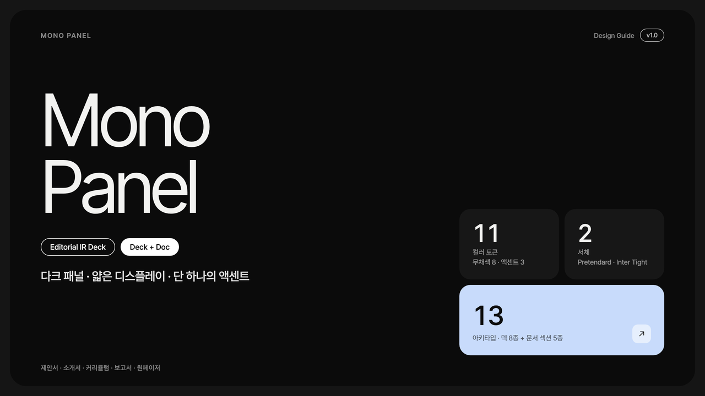
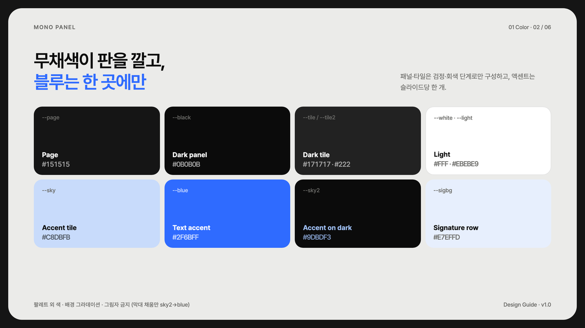
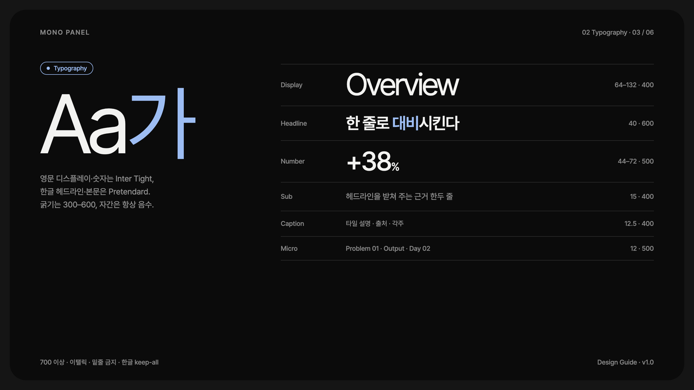
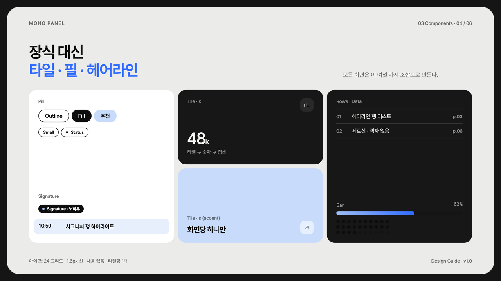
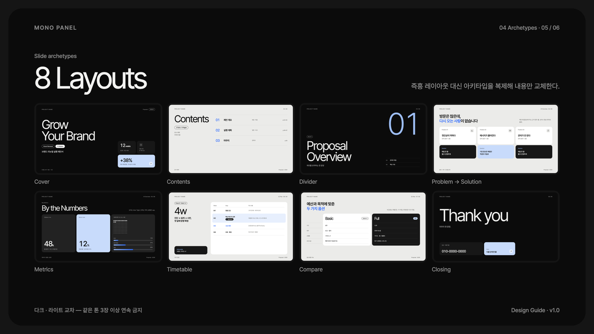
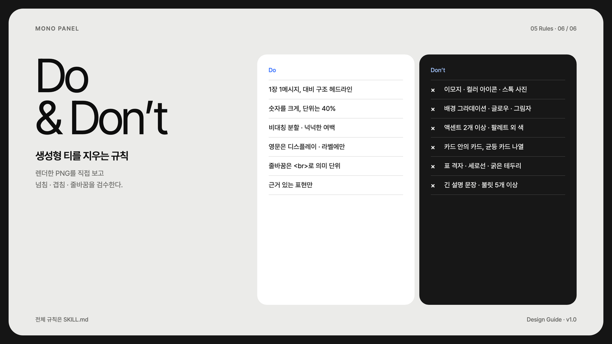
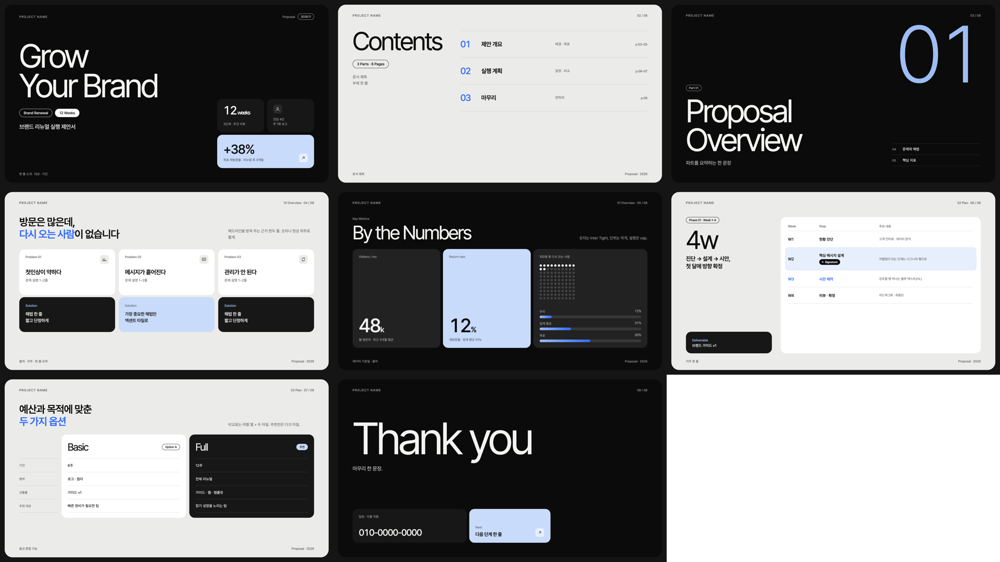
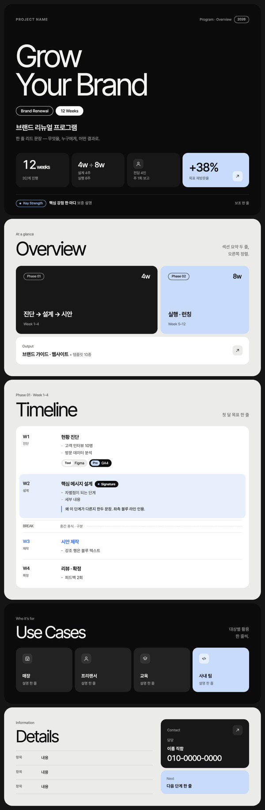
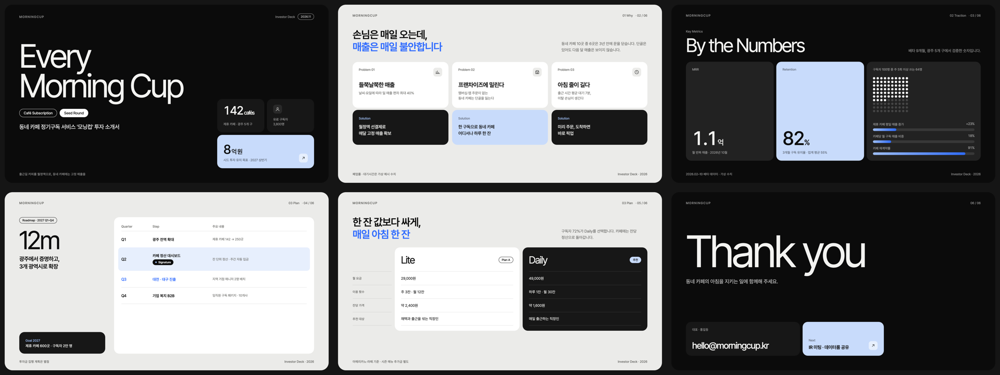

# Mono Panel

어두운 배경에 둥근 패널을 얹고, 얇은 영문 제목과 페일 블루 포인트 하나로 마무리하는 에디토리얼 IR덱 스타일입니다. 제안서·소개서·커리큘럼·보고서·원페이저에 씁니다.


| 항목 | 내용 |
|---|---|
| 포맷 | 슬라이드 덱 1280×720 · 세로 롱페이지 900px |
| 서체 | Pretendard (한글·본문) · Inter Tight (영문 디스플레이·숫자) |
| 컬러 | 무채색 8 + 액센트 3 (`#2F6BFF` · `#C8DBFB` · `#9DBDF3`) |
| 잘 맞는 문서 | 투자·사업 제안서, 교육 커리큘럼, 서비스 소개서, 성과 보고서 |

## 디자인 가이드 샘플

이 스타일로 만든 디자인 가이드 문서입니다. PDF는 [`guide/guide-sample.pdf`](guide/guide-sample.pdf), 원본은 [`guide/guide-sample.html`](guide/guide-sample.html)입니다.

| | |
|---|---|
|  |  |
| **Cover** — 표지 구성 | **Color** — 무채색 + 단일 액센트 |
|  |  |
| **Typography** — 서체 스케일 | **Components** — 필 · 타일 · 헤어라인 · 데이터 |
|  |  |
| **Archetypes** — 슬라이드 8종 | **Do & Don’t** — 생성형 티 지우기 |

## 템플릿 미리보기

**슬라이드 덱** — [`templates/deck.html`](templates/deck.html)



**세로 롱페이지** — [`templates/doc.html`](templates/doc.html)



**검증** — 맥락 없는 Claude가 `SKILL.md`만 읽고 처음부터 만든 투자 소개서입니다.



## 설치

이 폴더를 통째로 Claude Code 스킬 폴더에 복사합니다.

```bash
# 모든 프로젝트에서 사용
cp -R mono-panel-design ~/.claude/skills/
# 특정 프로젝트에서만 사용
cp -R mono-panel-design <project>/.claude/skills/

# PDF 렌더용 (한 번만)
pip install playwright pillow && python3 -m playwright install chromium
```

## 사용

Claude Code에 이렇게 요청합니다.

- "mono-panel-design 스킬로 우리 서비스 소개서 10장 만들어줘"
- "이 보고서를 mono panel 톤 한 장짜리 웹뷰 PDF로 정리해줘"

직접 렌더할 때는 아래 명령을 씁니다.

```bash
python3 scripts/render.py templates/deck.html ./out   # PDF + 장별 PNG + 한눈에 보기 이미지
python3 scripts/render.py templates/doc.html ./out    # 한 장 PDF + 전체 캡처
```

브랜드 색을 쓰려면 `assets/mono.css` 맨 위의 `--blue`, `--sky`, `--sky2`만 바꿉니다.

## 구성

```
mono-panel-design/
├── SKILL.md              Claude가 읽는 규칙서 (작업 순서 · 토큰 · 컴포넌트 · 아키타입 · 금지 · 검수)
├── assets/mono.css       스타일
├── assets/icons.md       선 아이콘 13종
├── templates/            deck.html · doc.html
├── scripts/render.py     HTML → PDF + 검수 PNG
├── guide/                디자인 가이드 샘플 (html · pdf)
└── preview/              README용 이미지 · thumbnail.png
```
