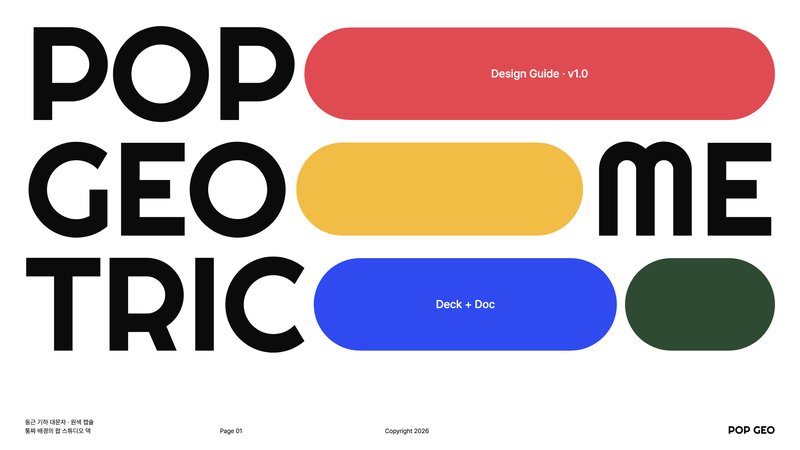
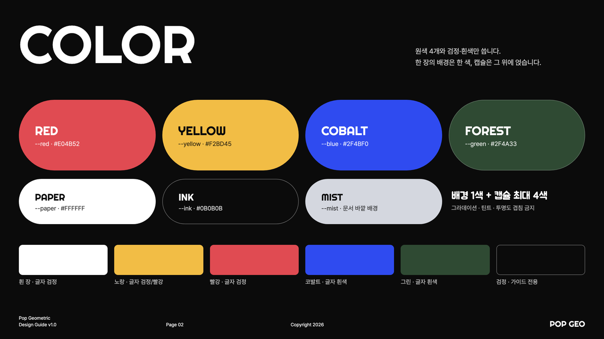
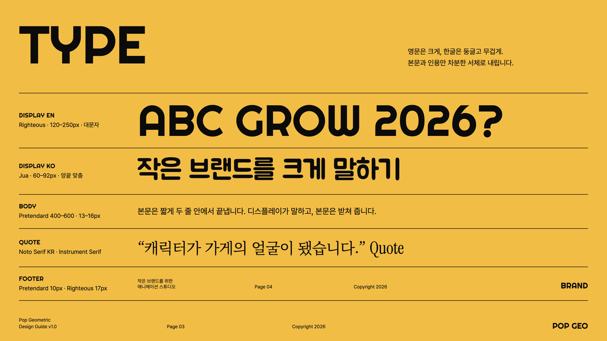
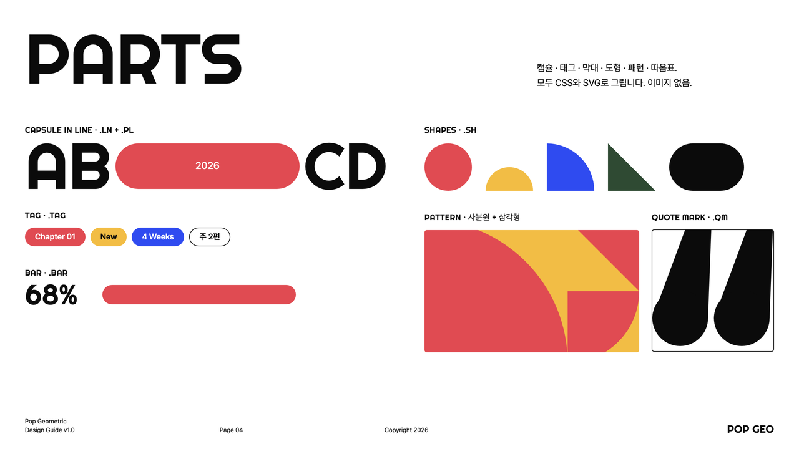
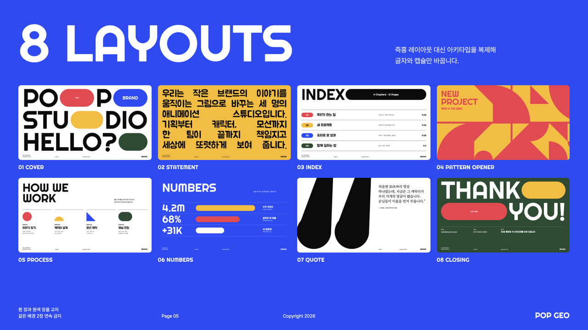
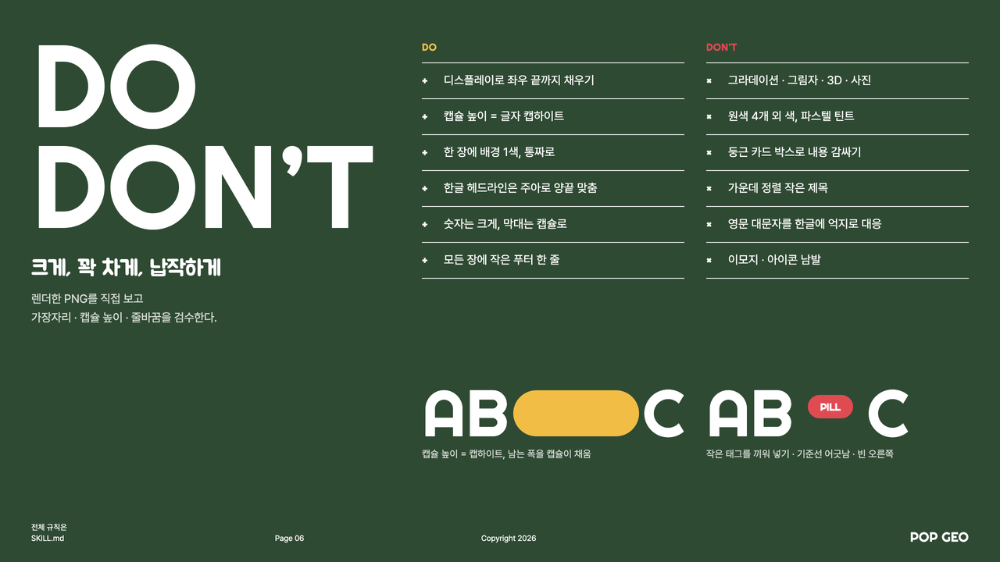
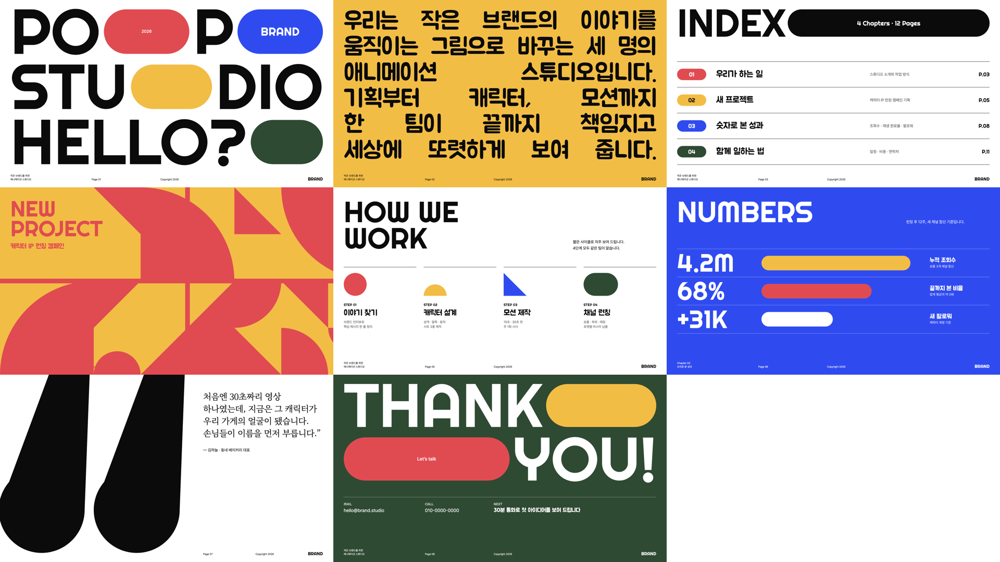
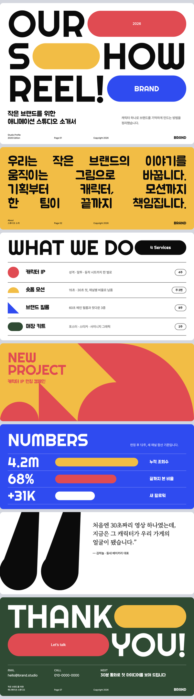

# Pop Geometric

둥근 기하 대문자를 화면 끝까지 키우고, 남는 자리를 빨강·노랑·코발트·그린 캡슐이 메우는 팝 스튜디오 스타일입니다. 통짜 원색 배경, 거대한 따옴표, 사분원·삼각형 패턴, 아주 작은 푸터 한 줄로 구성합니다. 회사 소개서·포트폴리오·캠페인 제안서·브랜드 덱에 씁니다.



| 항목 | 내용 |
|---|---|
| 포맷 | 슬라이드 덱 1280×720 · 세로 롱페이지 900px |
| 서체 | Righteous (영문 디스플레이·숫자) · Jua (한글 디스플레이) · Pretendard (본문) · Noto Serif KR / Instrument Serif (인용) |
| 컬러 | 원색 4 (`#E04B52` · `#F2BD45` · `#2F4BF0` · `#2F4A33`) + 흰색 · 검정 |
| 잘 맞는 문서 | 크리에이티브 스튜디오 소개서, 포트폴리오, 캠페인·런칭 제안서, 브랜드 덱 |

## 디자인 가이드 샘플

이 스타일로 만든 디자인 가이드 문서입니다. PDF는 [`guide/guide-sample.pdf`](guide/guide-sample.pdf), 원본은 [`guide/guide-sample.html`](guide/guide-sample.html)입니다.

| | |
|---|---|
|  |  |
| **Cover** — 꽉 찬 대문자 + 캡슐 | **Color** — 원색 4 + 흰·검정 |
|  |  |
| **Typography** — 영문 · 한글 · 본문 · 인용 | **Components** — 캡슐 · 태그 · 막대 · 도형 · 패턴 · 따옴표 |
|  |  |
| **Archetypes** — 슬라이드 8종 | **Do & Don’t** — 꽉 차게, 납작하게 |

## 템플릿 미리보기

**슬라이드 덱** — [`templates/deck.html`](templates/deck.html)



**세로 롱페이지** — [`templates/doc.html`](templates/doc.html)



## 설치

이 폴더를 통째로 Claude Code 스킬 폴더에 복사합니다.

```bash
# 모든 프로젝트에서 사용
cp -R pop-geometric ~/.claude/skills/
# 특정 프로젝트에서만 사용
cp -R pop-geometric <project>/.claude/skills/

# PDF 렌더용 (한 번만)
pip install playwright pillow && python3 -m playwright install chromium
```

## 사용

Claude Code에 이렇게 요청합니다.

- "pop-geometric 스킬로 우리 스튜디오 소개서 8장 만들어줘"
- "이 캠페인 기획안을 팝 지오메트릭 톤 롱페이지로 정리해줘"

직접 렌더할 때는 아래 명령을 씁니다.

```bash
python3 scripts/render.py templates/deck.html ./out   # PDF + 장별 PNG + 한눈에 보기 이미지
python3 scripts/render.py templates/doc.html ./out    # 한 장 PDF + 전체 캡처
```

브랜드 색을 쓰려면 `assets/pop.css` 맨 위의 원색 4개(`--red`, `--yellow`, `--blue`, `--green`) 중 하나만 바꿉니다.

## 서체 대체

레퍼런스의 커스텀 라운드 지오메트릭 대문자는 무료 웹폰트 **Righteous**로 대체했습니다. 한글은 같은 둥근 헤비 느낌의 **Jua**로 세팅하고, 긴 영문 대문자 문장은 한글 양끝 맞춤 문장으로 옮깁니다(SKILL.md §3).

## 구성

```
pop-geometric/
├── SKILL.md              Claude가 읽는 규칙서 (작업 순서 · 토큰 · 컴포넌트 · 아키타입 · 금지 · 검수)
├── assets/pop.css        스타일 · 토큰
├── templates/            deck.html · doc.html
├── scripts/render.py     HTML → PDF + 검수 PNG
├── guide/                디자인 가이드 샘플 (html · pdf · 아키타입 썸네일)
└── preview/              README용 이미지 · thumbnail.png
```
