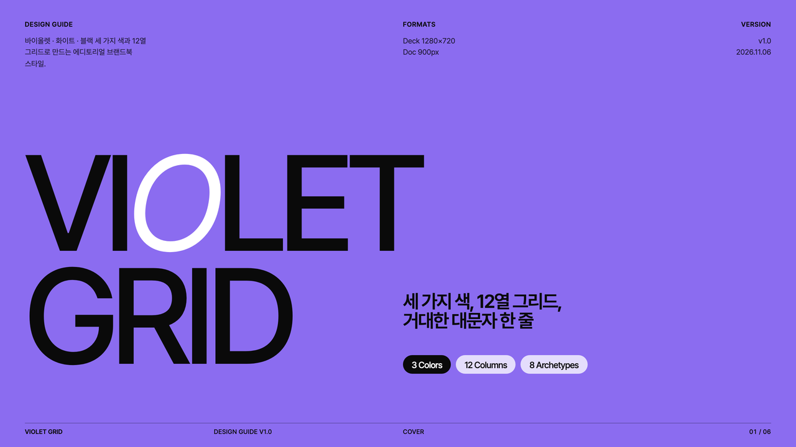
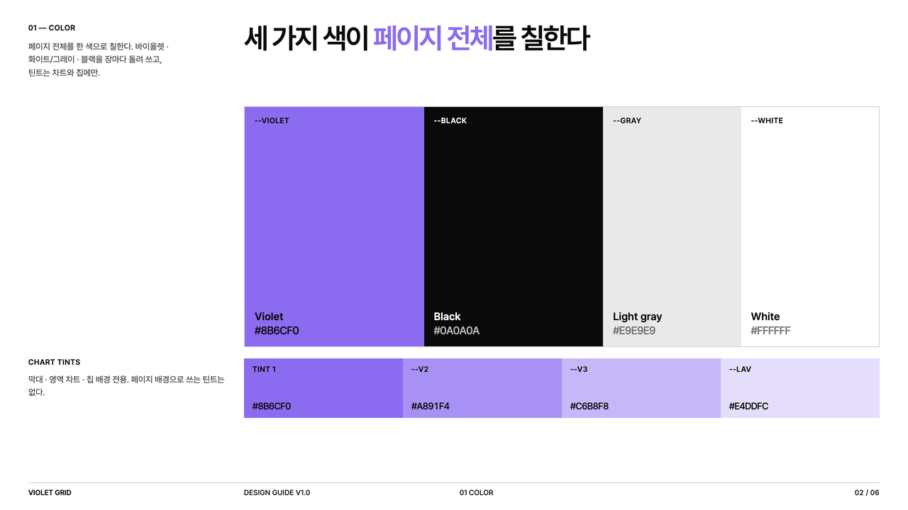
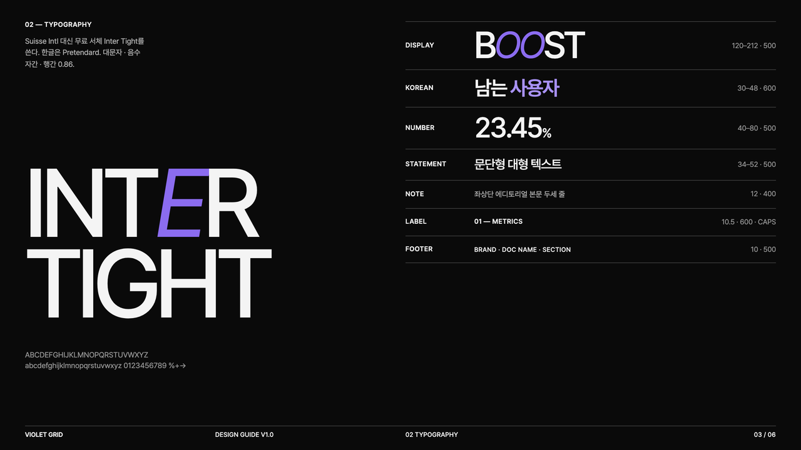
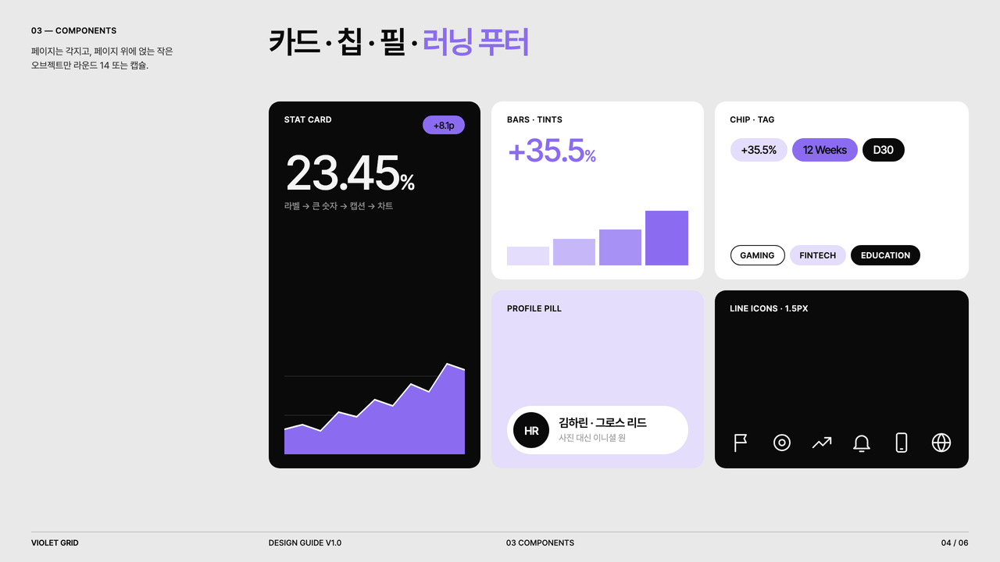
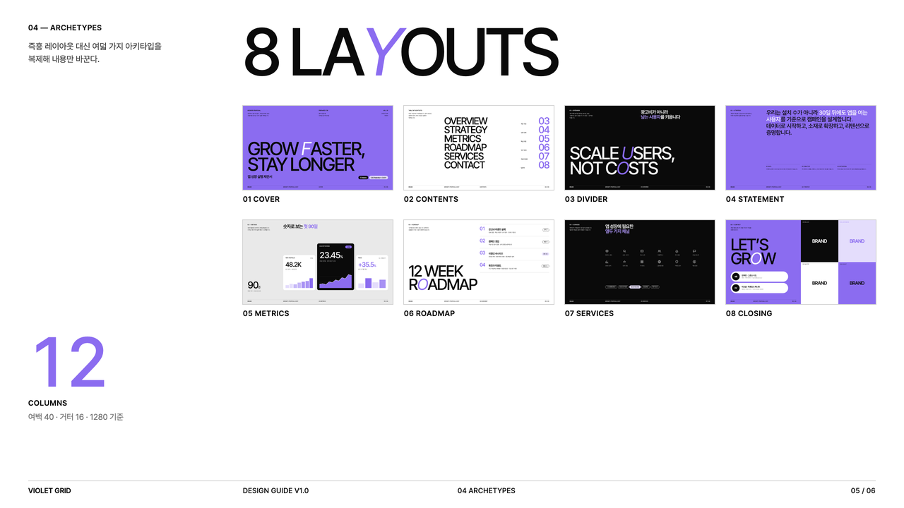
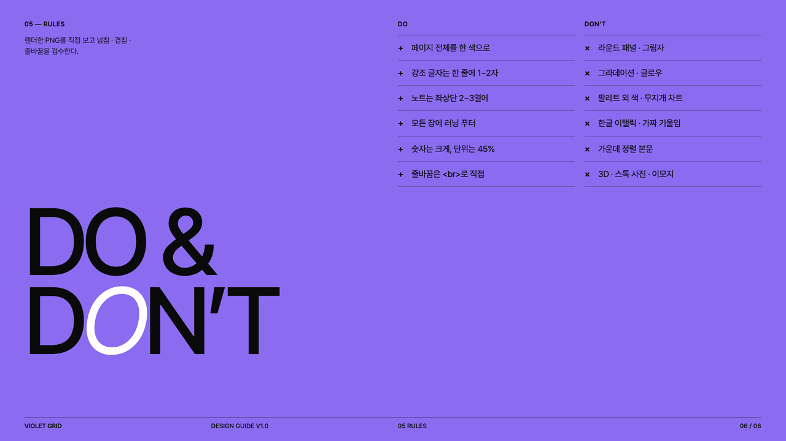

# Violet Grid

바이올렛·화이트·블랙 세 가지 색으로 페이지 전체를 칠하고, 12열 그리드 위에 거대한 대문자 제목과 작은 에디토리얼 노트를 대비시키는 브랜드북 스타일입니다. 브랜드 가이드·회사 소개서·마케팅 제안서·성과 리포트에 씁니다.


| 항목 | 내용 |
|---|---|
| 포맷 | 슬라이드 덱 1280×720 · 세로 롱페이지 900px |
| 서체 | Pretendard (한글·본문) · Inter Tight (영문 디스플레이·숫자, Suisse Intl 대체) |
| 컬러 | 3색 시스템 `#8B6CF0` · `#FFFFFF`/`#E9E9E9` · `#0A0A0A` + 차트 틴트 3 (`#A891F4` · `#C6B8F8` · `#E4DDFC`) |
| 잘 맞는 문서 | 브랜드 가이드, 에이전시·서비스 소개서, 마케팅 제안서, 성과 리포트 |

## 디자인 가이드 샘플

이 스타일로 만든 디자인 가이드 문서입니다. PDF는 [`guide/guide-sample.pdf`](guide/guide-sample.pdf), 원본은 [`guide/guide-sample.html`](guide/guide-sample.html)입니다.

| | |
|---|---|
|  |  |
| **Cover** — 표지 구성 | **Color** — 3색 풀블리드 + 차트 틴트 |
|  |  |
| **Typography** — 서체 스케일 | **Components** — 카드 · 칩 · 필 · 아이콘 |
|  |  |
| **Archetypes** — 슬라이드 8종 | **Do & Don’t** — 생성형 티 지우기 |

## 템플릿 미리보기

**슬라이드 덱** — [`templates/deck.html`](templates/deck.html)


**세로 롱페이지** — [`templates/doc.html`](templates/doc.html)


## 설치

이 폴더를 통째로 Claude Code 스킬 폴더에 복사합니다.

```bash
# 모든 프로젝트에서 사용
cp -R violet-grid ~/.claude/skills/
# 특정 프로젝트에서만 사용
cp -R violet-grid <project>/.claude/skills/

# PDF 렌더용 (한 번만)
pip install playwright pillow && python3 -m playwright install chromium
```

## 사용

Claude Code에 이렇게 요청합니다.

- "violet-grid 스킬로 우리 에이전시 소개서 8장 만들어줘"
- "이 성과 보고서를 바이올렛 그리드 톤 한 장짜리 웹뷰 PDF로 정리해줘"

직접 렌더할 때는 아래 명령을 씁니다.

```bash
python3 scripts/render.py templates/deck.html ./out   # PDF + 장별 PNG + 한눈에 보기 이미지
python3 scripts/render.py templates/doc.html ./out    # 한 장 PDF + 전체 캡처
```

브랜드 색을 쓰려면 `assets/violet-grid.css` 맨 위의 `--violet`, `--v2`, `--v3`, `--lav`만 같은 계열로 바꿉니다.

## 구성

```
violet-grid/
├── SKILL.md                  Claude가 읽는 규칙서 (작업 순서 · 토큰 · 컴포넌트 · 아키타입 · 금지 · 검수)
├── assets/violet-grid.css    스타일 (토큰 · 12열 배치 유틸 · 컴포넌트)
├── assets/icons.md           흰 선 아이콘 24종
├── templates/                deck.html · doc.html
├── scripts/render.py         HTML → PDF + 검수 PNG
├── guide/                    디자인 가이드 샘플 (html · pdf · 아키타입 썸네일)
└── preview/                  README용 이미지 · thumbnail.png
```
